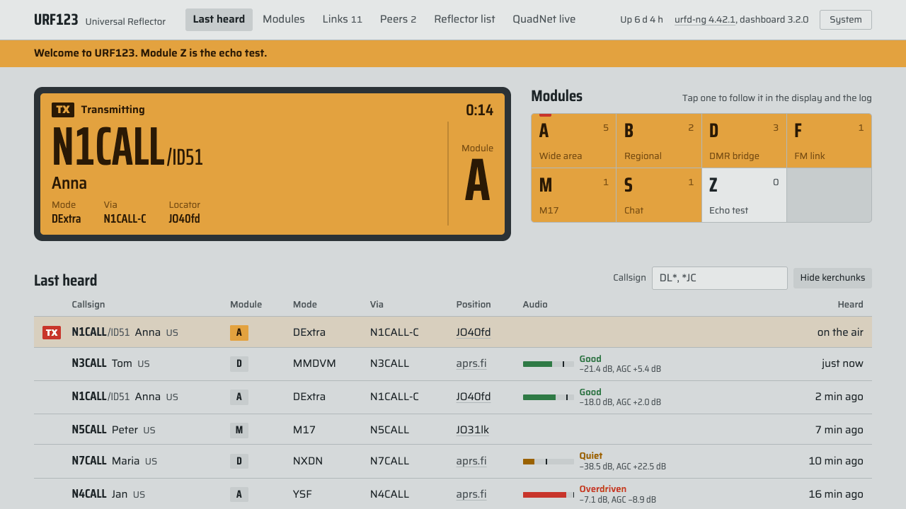
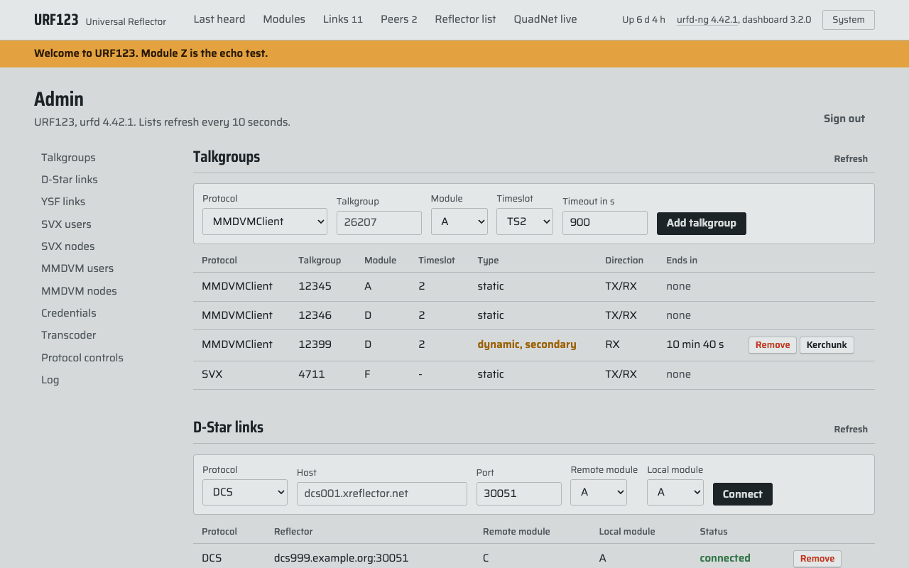
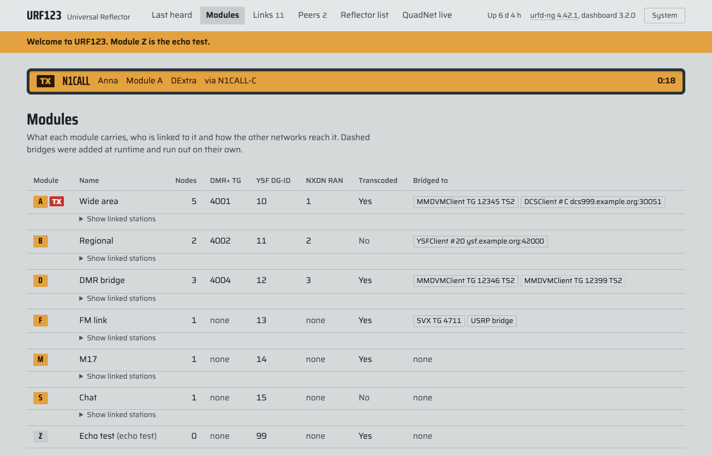
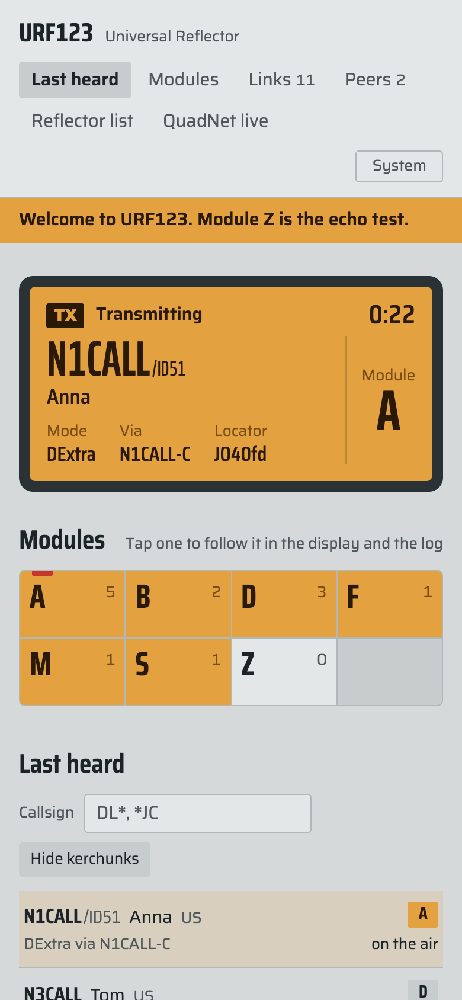

# urfd-ng - Universal Digital Voice Reflector und Transcoder

[English](README.md) | **Deutsch**

Basiert auf [urfd](https://github.com/n7tae/urfd) von Thomas Early N7TAE, mit erweiterten Funktionen, dem hybriden Transcoder [tcd](tcd/) und einem Setup-Script, das beides installiert.

**urfd 4.42.3** | tcd 0.23.5 | Dashboard v3.2.1

**Neu hier? Mit dem Setup-Script installieren, siehe [docs/INSTALL.de.md](docs/INSTALL.de.md):**

```bash
git clone https://github.com/jcmerg/urfd-ng.git urfd && cd urfd && sudo ./setup.sh
```

<p align="center">
<picture>
  <source media="(prefers-color-scheme: dark)" srcset="docs/images/dashboard-last-heard-dark.png">
  
</picture>
</p>

*Das Dashboard (Beispieldaten): wer auf Sendung ist, die Module als Tastenfeld, die Last-Heard-Liste mit dem Klang jedes Durchgangs. Es folgt dem hellen oder dunklen Design.*

## Was urfd-ng ist

urfd ist ein Multiprotokoll-Reflektor für digitale Sprache: Stationen mit D-Star, DMR, YSF, M17, P25, NXDN, SvxLink (FM) und AllStar treffen sich auf bis zu 26 Modulen (A-Z) und hören einander. Der Transcoder **tcd** in [`tcd/`](tcd/) setzt die Sprache einer Betriebsart in die anderen um; Reflektor und Transcoder stammen so immer aus derselben Version. Ohne Transcoder läuft urfd auch, Stationen hören dann aber nur die mit demselben Codec.

urfd läuft im Dual-Stack (IPv4 + IPv6) und koppelt sich mit anderen URF-, XLX-, DCS- und M17-Reflektoren.

## Funktionen

**Stationen verbinden sich direkt**
- D-Star: DPlus, DExtra, DCS, G3 (Icom Terminal- und Access-Point-Modus)
- DMR: MMDVM-Hotspots und -Repeater (HomeBrew-Protokoll, beide Zeitschlitze, statische und dynamische Sprechgruppen, Talker Alias), DMR+
- YSF (Wires-X-Räume, Modulwahl per DG-ID, DN und VW), M17, P25, NXDN (Modul per RAN oder Ziel-ID)
- SvxLink-Knoten (SVXServer), AllStar-Knoten (USRP)

**urfd verbindet sich mit anderen Netzen**
- DMR-Master wie BrandMeister, TGIF oder FreeDMR als bis zu 9 Hotspots (MMDVMClient), mit der BrandMeister-API für statische Sprechgruppen
- DMR-Netze Server zu Server (OpenBridge: HBlink, FreeDMR, BrandMeister)
- SvxReflector-Server (z.B. FM-Funknetz), D-Star-Reflektoren (DCS, DExtra, DPlus) und YSF-Reflektoren als Client
- Interlinks mit URF-, XLX-, DCS- und M17-Reflektoren (mrefd)
- Protokolle aus Plugins, die beim Start geladen werden

**Audio**
- tcd mit DVSI-AMBE-Geräten (DV3000, DV3003) und/oder Codec-Plugins in Software; eine AGC bringt jeden Ruf auf denselben Pegel, egal von welchem Funkgerät oder aus welcher Betriebsart
- Verlorene Sprachframes werden aufgefüllt, wiederholte Schlussframes stummgeschaltet, leere DMR-Rufe ignoriert ([docs/AUDIO.de.md](docs/AUDIO.de.md))
- D-Star-Funkgeräte bekommen Name und Quelle eines transcodierten Rufs im Slow-Data-Text

**Betrieb**
- `setup.sh` installiert, aktualisiert und bedient Reflektor und Transcoder (Docker oder systemd, ein Rechner oder zwei)
- Statisches Dashboard mit Live-Aktualisierung über einen WebSocket, helles und dunkles Design, Admin-Seite
- Admin-Socket für Scripte, Neuladen von Zuordnungen und Listen per SIGHUP, `inicheck` für die `urfd.ini`
- Modulzugang je Protokoll, Protokollsperren, Logins aus einer Zugangsdatenbank
- Eintrag im XLX-Verzeichnis, damit Hotspot-Software den Reflektor anbietet

## Installation

`setup.sh` stellt ein paar Fragen, schreibt `urfd.ini` und `tcd.ini`, installiert bei Bedarf Docker und baut und startet alles. Reflektor und Dashboard laufen in Docker, der Transcoder in Docker oder mit systemd, mit AMBE-Geräten oder in Software mit einem [Codec-Plugin](tcd/README.de.md#codec-plugins), auf demselben oder einem zweiten Rechner. Erneut aufgerufen, oder mit `sudo ./setup.sh update`, aktualisiert es und behält die Konfiguration.

```bash
git clone https://github.com/jcmerg/urfd-ng.git urfd
cd urfd
sudo ./setup.sh
```

| Anleitung | Inhalt |
|-----------|--------|
| [docs/INSTALL.de.md](docs/INSTALL.de.md) | Schritt für Schritt mit dem Setup-Script |
| [docs/INSTALL-ADVANCED.de.md](docs/INSTALL-ADVANCED.de.md) | Von Hand: Reflektor in Docker oder ohne, Dashboard auf dem eigenen Webserver, Transcoder allein |
| [docker/README.md](docker/README.md) | Das Docker-Image und seine Container |
| [tcd/README.de.md](tcd/README.de.md) | Der Transcoder: Hardware, Codec-Plugins, Pegel, Überwachung |

Von Hand (Docker nimmt seine Konfiguration aus `/opt/urfd`, `reflector/build.sh` aus `/usr/local/etc/urfd/`, `tcd/build.sh` aus `/usr/local/etc/tcd.ini`):

```bash
cd docker && docker compose build && docker compose up -d   # Reflektor in Docker
sudo bash reflector/build.sh                                 # oder urfd ohne Docker, mit systemd-Unit
sudo bash tcd/build.sh                                       # tcd
```

Der urfd-Container betreibt **urfd** und **nginx** (das Dashboard auf Port 8363, urfds WebSocket unter `/ws`, die zwischengespeicherte Reflektorliste des XLX-Verzeichnisses und den QuadNet-Feed sowie den Monitor des Docker-tcd unter `/tcd/`).

## Konfiguration

Die Konfiguration des Reflektors liegt in `/opt/urfd/config/` (Docker, in den Container eingebunden) oder `/usr/local/etc/urfd/` (nativ):

| Datei | Zweck |
|-------|-------|
| `urfd.ini` | Der Reflektor, seine Protokolle und das Dashboard (`[Dashboard]`); das meiste lässt sich per SIGHUP neu laden |
| `urfd.interlink` | Partner-Reflektoren (URF, XLX, DCS, M17) |
| `urfd.blacklist` / `urfd.whitelist` | Zugangskontrolle (per SIGHUP neu geladen) |
| `urfd.terminal` | G3 (Icom Terminal- / Access-Point-Modus), neu geladen, wenn sich die Datei ändert |
| `tcd.ini` | Der Transcoder, in `/opt/urfd/tcd/` (Docker) oder `/usr/local/etc/` (nativ), siehe [tcd/README.de.md](tcd/README.de.md) |

Die Vorlagen in [`config/`](config/) führen jeden Schlüssel mit einem kurzen Hinweis auf. **[docs/CONFIGURATION.de.md](docs/CONFIGURATION.de.md)** beschreibt jede Funktion mit Beispielen:

- [Grundlagen](docs/CONFIGURATION.de.md#grundlagen): Namen, Module und ihre Sprechgruppen, Transcoder, eingeschaltete Protokolle, externe Adresse, ID-Datenbanken, Modulzugang je Protokoll
- [Eintrag im XLX-Verzeichnis](docs/CONFIGURATION.de.md#xlx-verzeichnis-callinghome)
- DMR: [MMDVM-Server](docs/CONFIGURATION.de.md#mmdvm-server) (Hotspots), [MMDVMClient](docs/CONFIGURATION.de.md#mmdvmclient) (BrandMeister und andere Master), [OpenBridge](docs/CONFIGURATION.de.md#openbridge), [dynamische Sprechgruppen](docs/CONFIGURATION.de.md#dynamische-sprechgruppen)
- D-Star: [Client-Anbindungen](docs/CONFIGURATION.de.md#d-star-client-anbindungen-dcs-dextra-dplus), [Slow Data](docs/CONFIGURATION.de.md#d-star-slow-data-für-transcodierte-streams)
- [YSF](docs/CONFIGURATION.de.md#ysf), [M17](docs/CONFIGURATION.de.md#m17), [NXDN](docs/CONFIGURATION.de.md#nxdn)
- SvxLink: [SvxReflector-Client](docs/CONFIGURATION.de.md#svxreflector-client), [SVXServer](docs/CONFIGURATION.de.md#svxserver); AllStar: [USRP](docs/CONFIGURATION.de.md#usrp-allstar)
- [Protokolle sperren](docs/CONFIGURATION.de.md#protokolle-sperren), [Reflektor-Kopplung](docs/CONFIGURATION.de.md#reflektor-kopplung), [Echo-Modul](docs/CONFIGURATION.de.md#echo-modul), [Plugins](docs/CONFIGURATION.de.md#plugins)
- [Admin-Schnittstelle](docs/CONFIGURATION.de.md#admin-schnittstelle), [Zugangsdatenbank](docs/CONFIGURATION.de.md#zugangsdatenbank), [WebSocket](docs/CONFIGURATION.de.md#websocket), [Dashboard](docs/CONFIGURATION.de.md#dashboard)
- [Was ein SIGHUP neu lädt](docs/CONFIGURATION.de.md#konfiguration-per-sighup-neu-laden)

## Verwaltung

### setup.sh

Neben Installation und Update erledigt `setup.sh` die tägliche Arbeit am Reflektor (Docker-Container `urfd`) und am Transcoder (Docker-Container oder systemd-Dienst `tcd`), je nachdem, was davon auf dem Rechner läuft.

```bash
sudo ./setup.sh status              # was hier läuft, in welcher Version
sudo ./setup.sh restart [urfd|tcd]  # auch start, stop
sudo ./setup.sh logs [urfd|tcd]     # dem Log folgen (Strg-C beendet)
sudo ./setup.sh reload              # urfd liest seine Konfiguration neu: TG-Zuordnungen, Listen, Interlink (SIGHUP)
sudo ./setup.sh check               # urfd.ini mit inicheck prüfen
sudo ./setup.sh update              # pull, neu bauen, neu starten
```

Ohne `urfd` oder `tcd` wirken `status`, `start`, `stop` und `restart` auf alles Installierte, `logs` zeigt das Log des Reflektors; `reload` und `check` gelten für urfd. `reload` schickt das SIGHUP an urfd selbst, nicht an den Container: Dessen PID 1 ist supervisord, der bei SIGHUP alle Programme neu startet.

### inicheck

Prüft die `urfd.ini` auf Syntax und Querbezüge (z.B. müssen TG-Module in `[Modules]` stehen, transcodierte Protokolle brauchen einen Transcoder, das Echo-Modul muss ein konfiguriertes Modul sein).

```bash
cd reflector
cp -n ../config/urfd.mk .   # das Makefile braucht sie
make inicheck
./inicheck -q urfd.ini   # nur Fehler und Warnungen
./inicheck -n urfd.ini   # zusätzlich die öffentlichen Schlüssel ausgeben
./inicheck -v urfd.ini   # alle Schlüssel ausgeben (auch interne)
```

Exit-Code 0 = OK, 1 = Fehler gefunden. Warnungen (fehlende optionale Felder) führen zu keinem Exit-Code ungleich 0.

### Admin-Seite

Die Admin-Seite des Dashboards (π in der Fußzeile, mit `[Admin] Enable = true` und `[Dashboard] Admin = true`) verwaltet im laufenden Betrieb Sprechgruppen, D-Star- und YSF-Verbindungen, MMDVM- und SVX-Benutzer, Protokollsperren und Neuverbindungen und zeigt den Transcoder und das Log. Scripte schicken dieselben Befehle als JSON über einen TCP-Socket. Siehe [Admin-Schnittstelle](docs/CONFIGURATION.de.md#admin-schnittstelle).



*Die Admin-Seite nach der Anmeldung: Sprechgruppen, Verbindungen, Benutzer, Transcoder-Statistik und das Log.*

## Dashboard

Eine statische Seite (HTML und reines JavaScript, kein PHP), die den Zustand des Reflektors live über urfds WebSocket bekommt und eine Änderung im selben Moment zeigt. Ihre Einstellungen stehen in `[Dashboard]` der `urfd.ini`.

<p>
  
  
</p>

*Links die Seite Modules mit den Brücken jedes Moduls, rechts Last heard auf dem Handy.*

- **Last heard**: Ein bernsteinfarbenes LCD zeigt, wer auf Sendung ist, mit Modul, Betriebsart, Weg und laufender Zeit; eine Taste je Modul filtert LCD und Liste; der Rufzeichenfilter nimmt Platzhalter (`DL*`). Auf einem transcodierten Modul zeigt jeder Eintrag, wie der Durchgang klang (Pegel, AGC, Bitfehler, Verluste), siehe [docs/AUDIO.de.md](docs/AUDIO.de.md#wie-das-dashboard-einen-durchgang-bewertet). „Hide kerchunks“ blendet sehr kurze Durchgänge aus.
- **Modules**: jedes Modul mit verbundenen Knoten, DMR+-TG, YSF-DG-ID, NXDN-RAN und -Ziel-ID, Transcodierung und Brücken; die Server-Protokolle mit ihren Ports.
- **Links**, **Peers**: verbundene Knoten und Partner-Reflektoren, mit der IP, soweit `[Dashboard]` es erlaubt; beim dynamischen Modul eines Hotspots läuft die Zeit bis zur Trennung rückwärts.
- **Reflektorliste** (XLX-Verzeichnis) und **QuadNet live** (D-Star-Routing-Feed), beide über nginx mit Zwischenspeicher, so legt ein Ausfall des Verzeichnisses die Seite nicht lahm.
- **Admin** (versteckt): siehe oben.

Helles und dunkles Design, die Schrift vom Dashboard selbst ausgeliefert (keine Google Fonts), Locator von Stationen, die eine Position senden (M17 GNSS, D-Star DPRS, YSF GPS), mit Link zu OpenStreetMap, ein Banner aus `[Dashboard] Motd`, Modulnamen aus der `urfd.ini`. Einstellungen: [Dashboard](docs/CONFIGURATION.de.md#dashboard).

## Firewall

Nur die Ports der eingeschalteten Protokolle öffnen. Alle sind eingehend; angegeben sind die Standardwerte, der Schlüssel in der `urfd.ini` ändert sie.

Offene Ports finden Internet-Scanner binnen Stunden. urfd weist sie ab und protokolliert eine abgewiesene Verbindung (Transcoder-, MMDVM- und SVXServer-Logins) einmal je Adresse und Art pro Stunde; die übrigen dieser Stunde fasst eine Zeile an ihrem Ende zusammen.

| Port | Transport | Protokoll | Zweck | Schlüssel |
|------|-----------|-----------|-------|-----------|
| 5300 | TCP + UDP | SVXServer | SvxLink-Knoten verbinden sich hier | `[SVXServer] Port` |
| 8363 | TCP | HTTP | Dashboard (Docker, oder nativ mit der mitgelieferten nginx-Konfiguration) | `listen` in `docker/nginx-dashboard.conf` |
| 8880 | UDP | DMR+ | DMR+ DMO-Modus | `[DMRPlus] Port` |
| 10002 | UDP | XLXPeer | XLX- und BrandMeister-Kopplung | `[XLXPeer] Port` |
| 10017 | UDP | URF | URF-Kopplung | `[URF] Port` |
| 10100 | TCP | Transcoder | tcd, nur wenn er auf einem anderen Rechner läuft | `[Transcoder] Port` |
| 12345, 12346 | UDP | G3 | Icom Terminal- und Access-Point-Modus | fest |
| 17000 | UDP | M17 | M17-Clients und mrefd-Kopplung | `[M17] Port` |
| 20001 | UDP | DPlus | D-Star DPlus | `[DPlus] Port` |
| 30001 | UDP | DExtra | D-Star DExtra | `[DExtra] Port` |
| 30051 | UDP | DCS | D-Star DCS | `[DCS] Port` |
| 34000 | UDP | USRP | AllStar-Knoten (urfd sendet an den `TxPort` des Knotens, 32000) | `[USRP] RxPort` |
| 40000 | UDP | G3 | Icom-Terminal-Sprache | fest |
| 41000 | UDP | P25 | P25 | `[P25] Port` |
| 41400 | UDP | NXDN | NXDN | `[NXDN] Port` |
| 42000 | UDP | YSF | YSF und Wires-X | `[YSF] Port` |
| 62030 | UDP | MMDVM | DMR-Hotspots und -Repeater | `[MMDVM] Port` |
| 62035 | UDP | OpenBridge | der Server des DMR-Netzes der Verbindung | `[OpenBridge] LocalPort` |

Nur lokal, nicht öffnen: der Admin-Socket (`[Admin] Port`, 10101) und der WebSocket (`[WebSocket] Port`, 10102, erreichbar über `/ws` des Dashboards).

Nur ausgehend, nichts zu öffnen: SvxReflector (zum Port des SvxLink-Servers, meist 5300), MMDVMClient (zum Master, `MasterPort`), die DCS-, DExtra-, DPlus- und YSF-Clients und die Meldung an das XLX-Verzeichnis.

## Dokumentation

| Dokument | Inhalt |
|----------|--------|
| [docs/INSTALL.de.md](docs/INSTALL.de.md), [docs/INSTALL-ADVANCED.de.md](docs/INSTALL-ADVANCED.de.md) | Installation |
| [docs/CONFIGURATION.de.md](docs/CONFIGURATION.de.md) | Jede Funktion mit ihren Einstellungen in der `urfd.ini` |
| [docs/AUDIO.de.md](docs/AUDIO.de.md) | Was urfd mit Sprachstreams macht, Pegel, und die Messungen dahinter |
| [docs/WEBSOCKET.md](docs/WEBSOCKET.md) | Nachrichten und Anfragen des WebSockets |
| [docs/CREDENTIALS.md](docs/CREDENTIALS.md) | Die Zugangsdatenbank |
| [docs/PLUGINS.md](docs/PLUGINS.md) | Wie ein Plugin auf der Admin-Seite erscheint |
| [tcd/README.de.md](tcd/README.de.md) | Der Transcoder |

Was sich in jeder Version geändert hat, steht in den [Release Notes](https://github.com/jcmerg/urfd-ng/releases).

## Unterschiede zum Original-urfd

- **In diesem Repository**: der Transcoder tcd (gebaut gegen den Transcoder-Code des Reflektors selbst), das Setup-Script, das statische Dashboard und die Docker-Dateien
- **Neue Protokolle und Anbindungen**: MMDVM-Server, MMDVMClient (mehrere Verbindungen, BrandMeister-API), OpenBridge, SvxReflector-Client, SVXServer, USRP, DCS/DExtra/DPlus- und YSF-Client-Anbindungen, mrefd-Kopplung, Protokoll-Plugins
- **Routing**: Sprechgruppen-Zuordnung je Modul und Zeitschlitz, dynamische Sprechgruppen, Modul-Sprechgruppen, Modulzugang je Protokoll, Protokollsperren, NXDN-Modulwahl per RAN und Ziel-ID, YSF DG-ID und VW
- **Audio**: eine AGC für alle Betriebsarten in tcd, Codec-Plugins, aufgefüllte verlorene Frames, stummgeschaltete Wiederholungen, Verstärkung je SvxLink-/AllStar-Verbindung
- **Betrieb**: Admin-Seite und -Socket, WebSocket, Neuladen per SIGHUP, Zugangsdatenbank, inicheck, Eintrag im XLX-Verzeichnis durch den Reflektor, externe Adresse im laufenden Betrieb verfolgt, ID-Datenbanken mit Ausweichquellen und Zwischenspeicher
- **Anzeige**: DMR Talker Alias, D-Star Slow Data mit Name und Quelle, Positionen aus M17, D-Star und YSF, ein Klangbericht zu jedem Durchgang
- **Übernommen aus [dbehnke/urfd](https://github.com/dbehnke/urfd)**: Bereinigung von Rufzeichen, Korrektur von YSF-Radio-ID-Kollisionen, Durchsetzung der Transcoder-Modul-ID, Modulwahl per DG-ID

Dank an Jason Kendall (coolacid) für den WebSocket-Notifier, die POSIX-Anbindung von tcd und die Idee der Zugangsdatenbank.

## Copyright

- Copyright (c) 2016 Jean-Luc Deltombe LX3JL und Luc Engelmann LX1IQ
- Copyright (c) 2022 Doug McLain AD8DP und Thomas A. Early N7TAE
- Copyright (c) 2024 Thomas A. Early N7TAE
- Copyright (c) 2025-2026 Jens-Christian Merg DL4JC (Erweiterungen von urfd-ng)
- tcd: Copyright (c) 2021 Thomas A. Early N7TAE; POSIX-Anbindung von Jason Kendall (2026); Erweiterungen von urfd-ng Jens-Christian Merg DL4JC
