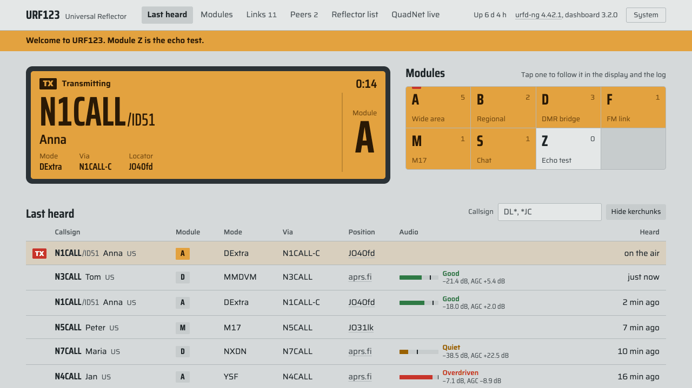
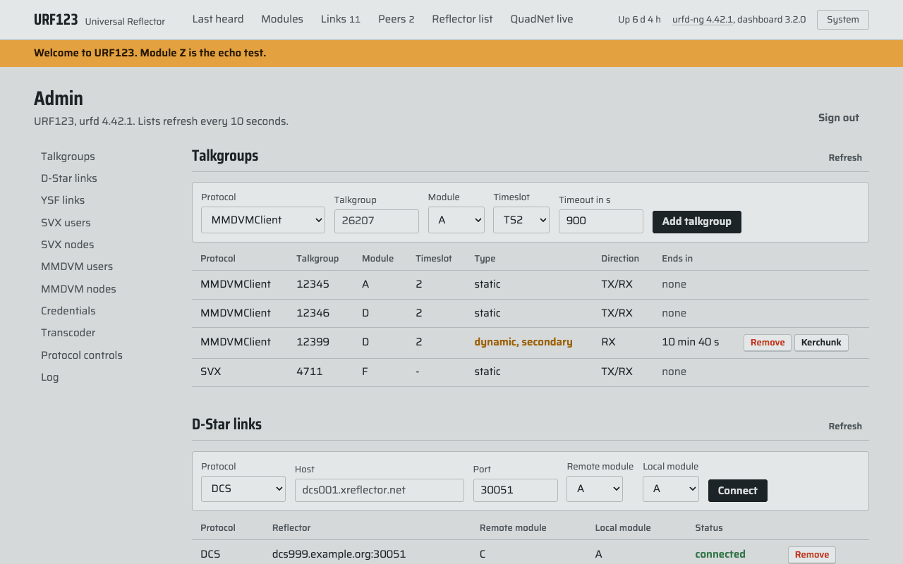
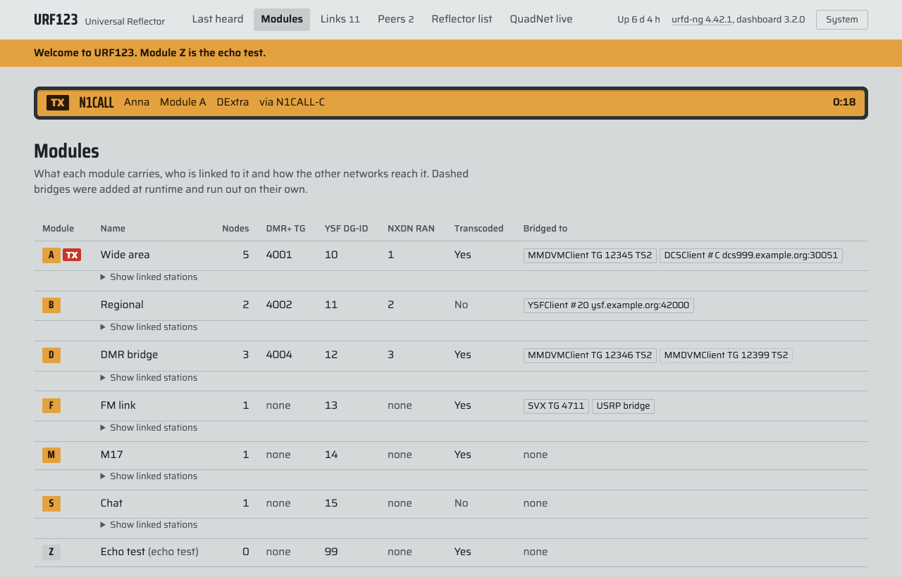
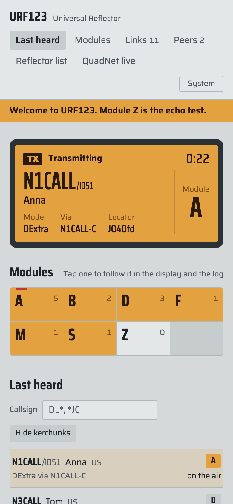

# urfd-ng - Universal Digital Voice Reflector and Transcoder

**English** | [Deutsch](README.de.md)

Based on [urfd](https://github.com/n7tae/urfd) by Thomas Early N7TAE, with extended features, the hybrid transcoder [tcd](tcd/) and a setup script that installs both.

**urfd 4.42.2** | tcd 0.23.2 | Dashboard v3.2.1

**New to this? Install with the setup script, see [docs/INSTALL.md](docs/INSTALL.md):**

```bash
git clone https://github.com/jcmerg/urfd-ng.git urfd && cd urfd && sudo ./setup.sh
```

<p align="center">
<picture>
  <source media="(prefers-color-scheme: dark)" srcset="docs/images/dashboard-last-heard-dark.png">
  
</picture>
</p>

*The dashboard (sample data): who is on the air, the modules as a keypad, the last heard log with how each transmission sounded. It follows the light or dark theme.*

## What urfd-ng is

urfd is a multi-protocol reflector for digital voice: stations on D-Star, DMR, YSF, M17, P25, NXDN, SvxLink (FM) and AllStar meet on up to 26 modules (A-Z) and hear each other. The transcoder **tcd** in [`tcd/`](tcd/) turns the voice of one mode into the others, so reflector and transcoder always come from the same version. Without a transcoder urfd still runs, but stations only hear those with the same codec.

urfd runs dual-stack (IPv4 + IPv6) and peers with other URF, XLX, DCS and M17 reflectors.

## Features

**Stations connect directly**
- D-Star: DPlus, DExtra, DCS, G3 (Icom Terminal and Access Point mode)
- DMR: MMDVM hotspots and repeaters (HomeBrew protocol, both timeslots, static and dynamic talkgroups, talker alias), DMR+
- YSF (Wires-X rooms, DG-ID module selection, DN and VW), M17, P25, NXDN (module by RAN or destination ID)
- SvxLink nodes (SVXServer), AllStar nodes (USRP)

**urfd connects to other networks**
- DMR masters such as BrandMeister, TGIF or FreeDMR as up to 9 hotspots (MMDVMClient), with the BrandMeister API for static talkgroups
- DMR networks server to server (OpenBridge: HBlink, FreeDMR, BrandMeister)
- SvxReflector servers (e.g. FM-Funknetz), D-Star reflectors (DCS, DExtra, DPlus) and YSF reflectors as a client
- Interlinks with URF, XLX, DCS and M17 (mrefd) reflectors
- Protocols from plugins loaded at start

**Audio**
- tcd with DVSI AMBE devices (DV3000, DV3003) and/or codec plugins in software; one AGC brings every call to the same level, whatever radio or mode it came from
- Lost voice frames are filled in, repeated end frames muted, empty DMR calls ignored ([docs/AUDIO.md](docs/AUDIO.md))
- D-Star radios get name and source of a transcoded call in the slow data text

**Operation**
- `setup.sh` installs, updates and runs reflector and transcoder (Docker or systemd, one machine or two)
- Static dashboard with live updates over a WebSocket, light and dark theme, admin page
- Admin socket for scripts, SIGHUP reload of mappings and lists, `inicheck` for `urfd.ini`
- Module access per protocol, protocol blocking, logins from a credential database
- Registration in the XLX directory, so hotspot software lists the reflector

## Installation

`setup.sh` asks a few questions, writes `urfd.ini` and `tcd.ini`, installs Docker if needed, and builds and starts everything. The reflector and its dashboard run in Docker, the transcoder in Docker or with systemd, with AMBE devices or in software with a [codec plugin](tcd/README.md#codec-plugins), on the same machine or on a second one. Run it again, or `sudo ./setup.sh update`, to update while keeping the configuration.

```bash
git clone https://github.com/jcmerg/urfd-ng.git urfd
cd urfd
sudo ./setup.sh
```

| Guide | Content |
|-------|---------|
| [docs/INSTALL.md](docs/INSTALL.md) | Step by step with the setup script |
| [docs/INSTALL-ADVANCED.md](docs/INSTALL-ADVANCED.md) | By hand: reflector in Docker or without, dashboard on your own web server, transcoder alone |
| [docker/README.md](docker/README.md) | The Docker image and its containers |
| [tcd/README.md](tcd/README.md) | The transcoder: hardware, codec plugins, levels, monitoring |

By hand, with the configuration in `/opt/urfd`:

```bash
cd docker && docker compose build && docker compose up -d   # reflector in Docker
sudo bash reflector/build.sh                                 # or urfd without Docker, with its systemd unit
sudo bash tcd/build.sh                                       # tcd
```

The urfd container runs **urfd** and **nginx** (the dashboard on port 8363, urfd's WebSocket at `/ws`, the cached XLX reflector list and QuadNet feed, and the Docker tcd's monitor at `/tcd/`).

## Configuration

All configuration is in `/opt/urfd/config/` (mounted into the container):

| File | Purpose |
|------|---------|
| `urfd.ini` | The reflector, its protocols and the dashboard (`[Dashboard]`); most of it reloads on SIGHUP |
| `urfd.interlink` | Peer reflectors (URF, XLX, DCS, M17) |
| `urfd.blacklist` / `urfd.whitelist` | Access control (reloaded on SIGHUP) |
| `urfd.terminal` | G3 (Icom Terminal / Access Point mode), reloaded when the file changes |
| `tcd.ini` | The transcoder, see [tcd/README.md](tcd/README.md) |

The templates in [`config/`](config/) explain every key. **[docs/CONFIGURATION.md](docs/CONFIGURATION.md)** describes each feature with examples:

- [Basics](docs/CONFIGURATION.md#basics): names, modules and their talkgroups, transcoder, enabled protocols, external address, ID databases, module access by protocol
- [XLX directory registration](docs/CONFIGURATION.md#xlx-directory-registration-callinghome)
- DMR: [MMDVM server](docs/CONFIGURATION.md#mmdvm-server) (hotspots), [MMDVMClient](docs/CONFIGURATION.md#mmdvmclient) (BrandMeister and other masters), [OpenBridge](docs/CONFIGURATION.md#openbridge), [dynamic talkgroups](docs/CONFIGURATION.md#dynamic-talkgroups)
- D-Star: [client connectors](docs/CONFIGURATION.md#d-star-client-connectors-dcs-dextra-dplus), [slow data](docs/CONFIGURATION.md#d-star-slow-data-for-transcoded-streams)
- [YSF](docs/CONFIGURATION.md#ysf), [M17](docs/CONFIGURATION.md#m17), [NXDN](docs/CONFIGURATION.md#nxdn)
- SvxLink: [SvxReflector client](docs/CONFIGURATION.md#svxreflector-client), [SVXServer](docs/CONFIGURATION.md#svxserver); AllStar: [USRP](docs/CONFIGURATION.md#usrp-allstar)
- [Blocking protocols](docs/CONFIGURATION.md#blocking-protocols), [interlinking](docs/CONFIGURATION.md#reflector-interlinking), [echo module](docs/CONFIGURATION.md#echo-module), [plugins](docs/CONFIGURATION.md#plugins)
- [Admin interface](docs/CONFIGURATION.md#admin-interface), [credential database](docs/CONFIGURATION.md#credential-database), [WebSocket](docs/CONFIGURATION.md#websocket), [dashboard](docs/CONFIGURATION.md#dashboard)
- [What a SIGHUP reloads](docs/CONFIGURATION.md#sighup-configuration-reload)

## Administration

### setup.sh

Besides installing and updating, `setup.sh` handles the day-to-day work on the reflector (Docker container `urfd`) and the transcoder (Docker container or systemd service `tcd`), whichever of the two runs on the machine.

```bash
sudo ./setup.sh status              # what runs here, in which version
sudo ./setup.sh restart [urfd|tcd]  # also start, stop
sudo ./setup.sh logs [urfd|tcd]     # follow the log (Ctrl-C ends it)
sudo ./setup.sh reload              # urfd rereads its config: TG mappings, lists, interlink (SIGHUP)
sudo ./setup.sh check               # check urfd.ini with inicheck
sudo ./setup.sh update              # pull, rebuild, restart
```

Without `urfd` or `tcd`, the commands act on everything installed. `reload` sends SIGHUP to urfd itself, not to the container: its PID 1 is supervisord, which restarts all programs on SIGHUP.

### inicheck

Checks `urfd.ini` for syntax and cross-references (e.g. TG modules must exist in `[Modules]`, transcoded protocols need a transcoder, the echo module must be a configured module).

```bash
cd reflector
cp -n ../config/urfd.mk .   # the Makefile needs it
make inicheck
./inicheck -q urfd.ini   # errors and warnings only
./inicheck -n urfd.ini   # also print public config keys
./inicheck -v urfd.ini   # print all keys (including internal)
```

Exit code 0 = OK, 1 = errors found. Warnings (missing optional fields) don't cause a non-zero exit.

### Admin page

The dashboard's admin page (π in the footer, with `[Admin] Enable = true` and `[Dashboard] Admin = true`) manages talkgroups, D-Star and YSF links, MMDVM and SVX users, protocol blocks and reconnects at runtime, and shows the transcoder and the log. Scripts send the same commands as JSON over a TCP socket. See [Admin interface](docs/CONFIGURATION.md#admin-interface).



*The admin page after login: talkgroups, links, users, transcoder statistics and the log.*

## Dashboard

A static page (HTML and plain JavaScript, no PHP) that gets the reflector's state live over urfd's WebSocket and shows a change the moment it happens. Its settings are `[Dashboard]` in `urfd.ini`.

<p>
  
  
</p>

*Left the Modules page with each module's bridges, right Last heard on a phone.*

- **Last heard**: an amber LCD shows who is on the air with module, mode, route and a running timer; a key per module filters the LCD and the log; a callsign filter takes wildcards (`DL*`). On a transcoded module each entry shows how the transmission sounded (level, AGC, bit errors, losses), see [docs/AUDIO.md](docs/AUDIO.md#how-the-dashboard-rates-a-transmission). "Hide kerchunks" leaves out very short transmissions.
- **Modules**: each module with its linked nodes, DMR+ TG, YSF DG-ID, NXDN RAN and destination ID, transcoding and bridges; the server protocols with their ports.
- **Links**, **Peers**: linked nodes and peer reflectors, with the IP as far as `[Dashboard]` allows; a hotspot's dynamic module counts down until it unlinks.
- **Reflector list** (XLX directory) and **QuadNet live** (D-Star routing feed), both through nginx with a cache, so a directory outage does not break the page.
- **Admin** (hidden): see above.

Light and dark theme, its font served by itself (no Google Fonts), locators of stations that send a position (M17 GNSS, D-Star DPRS, YSF GPS) linked to OpenStreetMap, a banner from `[Dashboard] Motd`, module names from `urfd.ini`. Settings: [Dashboard](docs/CONFIGURATION.md#dashboard).

## Firewall

Open only the ports of the protocols you enable. All of them are incoming; the defaults are shown, the key in `urfd.ini` changes them.

Open ports are found by internet scanners within hours. urfd turns them away and logs a rejected connection (transcoder, MMDVM and SVXServer logins) once per address and kind each hour; the others of that hour are summed up in one line when it is over.

| Port | Transport | Protocol | Purpose | Key |
|------|-----------|----------|---------|-----|
| 5300 | TCP + UDP | SVXServer | SvxLink nodes connect here | `[SVXServer] Port` |
| 8363 | TCP | HTTP | Dashboard (Docker, or natively with the shipped nginx configuration) | `listen` in `docker/nginx-dashboard.conf` |
| 8880 | UDP | DMR+ | DMR+ DMO mode | `[DMRPlus] Port` |
| 10002 | UDP | XLXPeer | XLX and BrandMeister peering | `[XLXPeer] Port` |
| 10017 | UDP | URF | URF interlinking | `[URF] Port` |
| 10100 | TCP | Transcoder | tcd, only if it runs on another host | `[Transcoder] Port` |
| 12345, 12346 | UDP | G3 | Icom Terminal and Access Point mode | fixed |
| 17000 | UDP | M17 | M17 clients and mrefd interlinking | `[M17] Port` |
| 20001 | UDP | DPlus | D-Star DPlus | `[DPlus] Port` |
| 30001 | UDP | DExtra | D-Star DExtra | `[DExtra] Port` |
| 30051 | UDP | DCS | D-Star DCS | `[DCS] Port` |
| 34000 | UDP | USRP | AllStar node (urfd sends to the node's `TxPort`, 32000) | `[USRP] RxPort` |
| 40000 | UDP | G3 | Icom Terminal voice | fixed |
| 41000 | UDP | P25 | P25 | `[P25] Port` |
| 41400 | UDP | NXDN | NXDN | `[NXDN] Port` |
| 42000 | UDP | YSF | YSF and Wires-X | `[YSF] Port` |
| 62030 | UDP | MMDVM | DMR hotspots and repeaters | `[MMDVM] Port` |
| 62035 | UDP | OpenBridge | the DMR network's server of the link | `[OpenBridge] LocalPort` |

Local only, do not open: the admin socket (`[Admin] Port`, 10101) and the WebSocket (`[WebSocket] Port`, 10102, reached through the dashboard's `/ws`).

Outgoing only, nothing to open: SvxReflector (to the SvxLink server's port, usually 5300), MMDVMClient (to the master, `MasterPort`), the DCS, DExtra, DPlus and YSF clients, and the call home to the XLX directory.

## Documentation

| Document | Content |
|----------|---------|
| [docs/INSTALL.md](docs/INSTALL.md), [docs/INSTALL-ADVANCED.md](docs/INSTALL-ADVANCED.md) | Installation |
| [docs/CONFIGURATION.md](docs/CONFIGURATION.md) | Every feature with its `urfd.ini` settings |
| [docs/AUDIO.md](docs/AUDIO.md) | What urfd does to voice streams, levels, and the measurements behind it |
| [docs/WEBSOCKET.md](docs/WEBSOCKET.md) | The WebSocket's messages and requests |
| [docs/CREDENTIALS.md](docs/CREDENTIALS.md) | The credential database |
| [docs/PLUGINS.md](docs/PLUGINS.md) | How a plugin shows up on the admin page |
| [tcd/README.md](tcd/README.md) | The transcoder |

What changed in each version is in the [release notes](https://github.com/jcmerg/urfd-ng/releases).

## Differences from upstream urfd

- **In this repository**: the transcoder tcd (built against the reflector's own transcoder code), the setup script, the static dashboard and Docker files
- **New protocols and connectors**: MMDVM server, MMDVMClient (several connections, BrandMeister API), OpenBridge, SvxReflector client, SVXServer, USRP, DCS/DExtra/DPlus and YSF client connectors, mrefd interlink, protocol plugins
- **Routing**: talkgroup mappings per module and timeslot, dynamic talkgroups, module talkgroups, module access per protocol, protocol blocking, NXDN module selection by RAN and destination ID, YSF DG-ID and VW
- **Audio**: one AGC for all modes in tcd, codec plugins, lost frames filled in, repeated frames muted, gains per SvxLink/AllStar connection
- **Operation**: admin page and socket, WebSocket, SIGHUP reload, credential database, inicheck, XLX directory registration by the reflector, external address followed while running, ID databases with fallback sources and a cache
- **Display**: DMR talker alias, D-Star slow data with name and source, positions from M17, D-Star and YSF, an audio report of each transmission
- **Cherry-picked from [dbehnke/urfd](https://github.com/dbehnke/urfd)**: callsign sanitization, YSF radio ID collision fix, transcoder module ID enforcement, DG-ID module selection

Thanks to Jason Kendall (coolacid) for the WebSocket notifier, the POSIX serial backend of tcd and the idea of the credential database.

## Copyright

- Copyright (c) 2016 Jean-Luc Deltombe LX3JL and Luc Engelmann LX1IQ
- Copyright (c) 2022 Doug McLain AD8DP and Thomas A. Early N7TAE
- Copyright (c) 2024 Thomas A. Early N7TAE
- Copyright (c) 2025-2026 Jens-Christian Merg DL4JC (urfd-ng extensions)
- tcd: Copyright (c) 2021 Thomas A. Early N7TAE; POSIX serial backend by Jason Kendall (2026); urfd-ng extensions Jens-Christian Merg DL4JC
