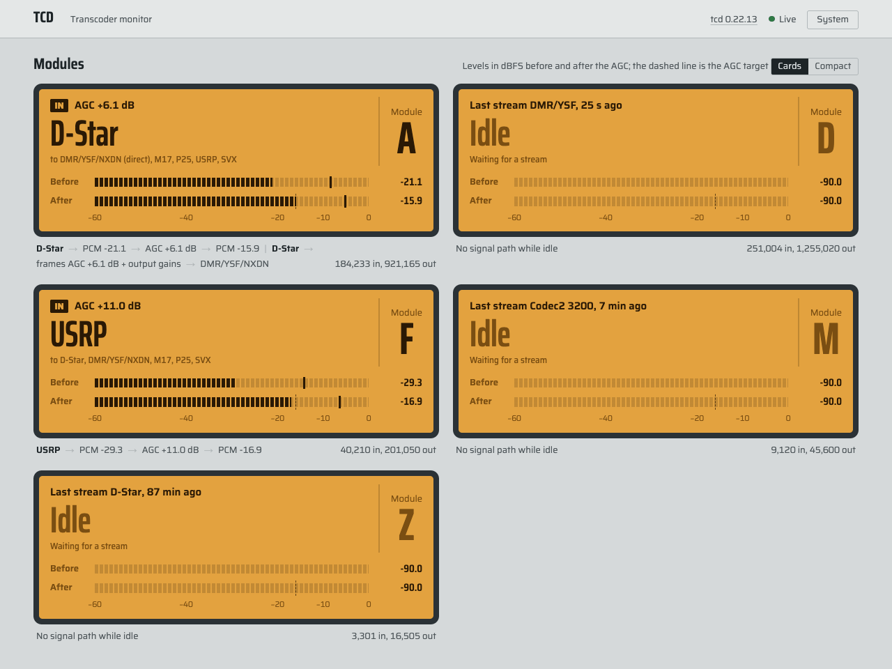
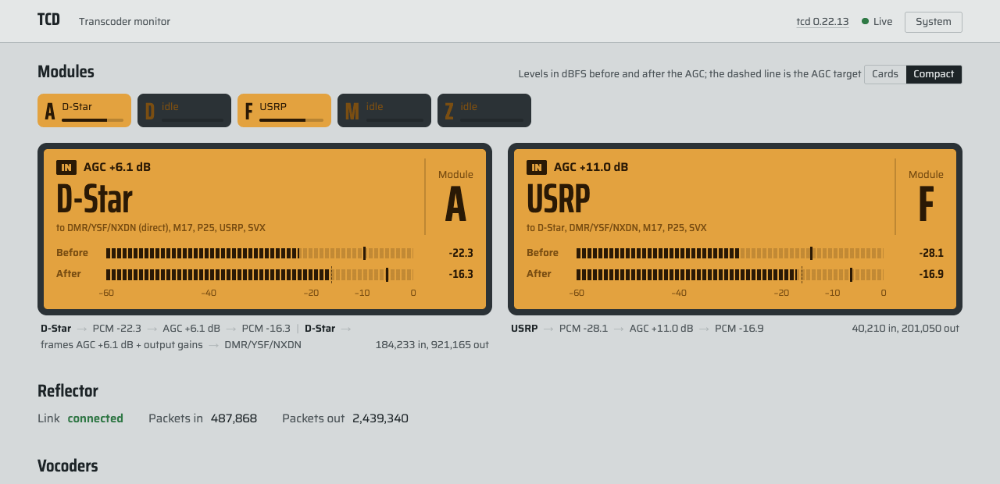
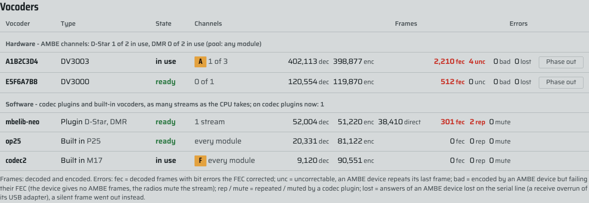
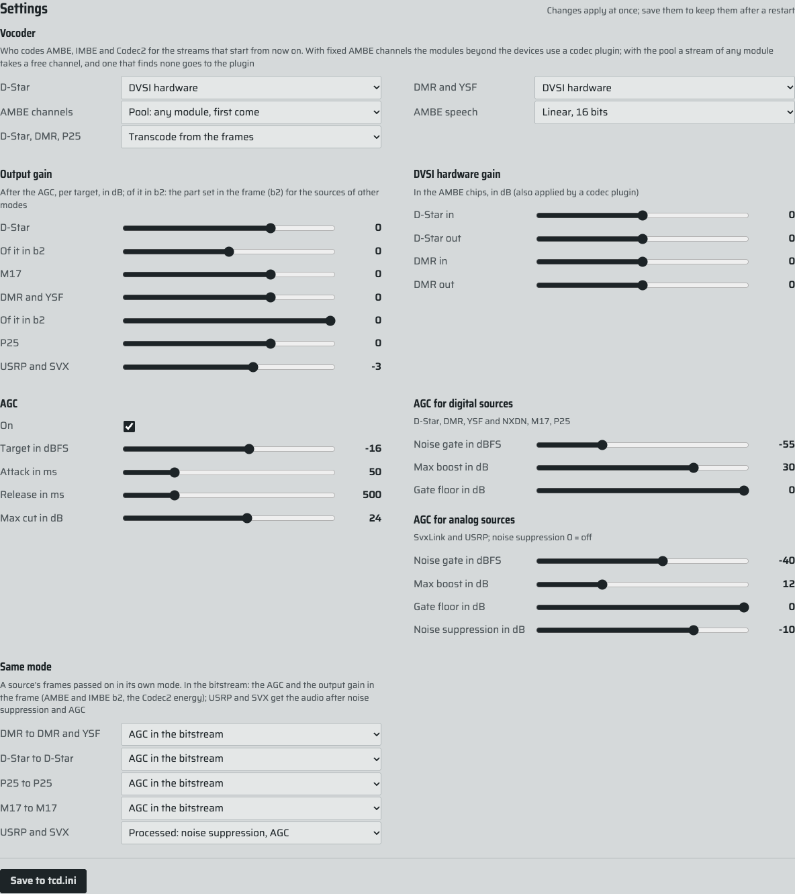

# tcd — Hybrider Transcoder für digitale Sprache

[English](README.md) | **Deutsch**

**Version 0.22.13** — der Transcoder von [urfd-ng](../README.de.md), im Ordner `tcd/` desselben Repositorys. Basiert auf [n7tae/tcd](https://github.com/n7tae/tcd). Was sich von Version zu Version geändert hat, steht in den [Release Notes](https://github.com/jcmerg/urfd-ng/releases).

tcd wandelt Sprache zwischen den digitalen Betriebsarten eines URF-Reflektors um, damit ein D-Star-Nutzer einen DMR-Nutzer hört und umgekehrt. Der Reflektor gibt das Audio seiner transcodierten Module über TCP an tcd und bekommt alle anderen Betriebsarten zurück.

- **D-Star** (AMBE) und **DMR/YSF/NXDN** (AMBE2+) auf DVSI-AMBE-Hardware (DV3000, DV3003 und Verwandte) oder in Software mit einem [Codec-Plugin](#codec-plugins)
- **P25** (IMBE, auch YSF VW) mit dem eigenen OP25-Vocoder von tcd, **M17** mit dem eigenen Codec2; auch diese kann ein Codec-Plugin übernehmen
- eine **AGC**, die jeden Durchgang auf denselben Pegel bringt, egal von welchem Funkgerät oder Vocoder er kommt, auch DMR → DMR/YSF ohne Neucodierung
- Rauschunterdrückung für **analoge Quellen** (SvxLink, AllStar)
- ein **Web-Dashboard** und der Terminal-Monitor **tcdmon**, mit Live-Pegelanzeigen und Einstellungen

<picture>
  <source media="(prefers-color-scheme: dark)" srcset="../docs/images/tcd-monitor-dark.png">
  
</picture>

*Das Web-Dashboard von tcd (Beispieldaten): je Modul der Eingangs-Codec, seine Ziele, die Pegel vor und nach der AGC und der Signalweg.*

## Inhalt

- [Installation](#installation)
- [Hardware](#hardware)
- [Codec-Plugins](#codec-plugins)
- [tcd in Docker](#tcd-in-docker)
- [AMBE-Geräte auswählen](#ambe-geräte-auswählen)
- [Konfiguration (tcd.ini)](#konfiguration-tcdini)
- [Pegel](#pegel)
- [Überwachung](#überwachung)
- [Betrieb und Fehlersuche](#betrieb-und-fehlersuche)
- [Änderungen gegenüber dem Original](#änderungen-gegenüber-dem-original)

Die Messungen und Hörtests hinter den Voreinstellungen stehen in [docs/MEASUREMENTS.de.md](docs/MEASUREMENTS.de.md), die Modul-Worker im Einzelnen in [docs/WORKERS.de.md](docs/WORKERS.de.md), die AGC und der Gain bei gleicher Betriebsart in [docs/LEVELS.de.md](docs/LEVELS.de.md).

## Installation

### Mit dem Setup-Script

Am einfachsten: Das Setup-Script im Hauptverzeichnis installiert Reflektor und Transcoder zusammen, oder den Transcoder allein auf einem zweiten Rechner, stellt ein paar Fragen und schreibt die `tcd.ini`. Siehe [docs/INSTALL.de.md](../docs/INSTALL.de.md).

```bash
git clone https://github.com/jcmerg/urfd-ng.git urfd
cd urfd
sudo ./setup.sh
```

### Mit build.sh

Nur den Transcoder bauen und installieren:

```bash
git clone https://github.com/jcmerg/urfd-ng.git urfd
cd urfd
sudo bash tcd/build.sh
```

`build.sh` installiert die Build-Werkzeuge, `libspeexdsp-dev`, `libwebsockets-dev` und `libncurses-dev`, baut tcd als Besitzer des Klons und installiert `tcd`, `tcdmon`, `agc-analyze` und die systemd-Unit. Ein Codec-Plugin in `tcd/plugins/<name>/` (ein `git clone` seines Repositorys, siehe [Codec-Plugins](#codec-plugins)) wird mitgebaut und nach `/usr/local/lib/tcd/` installiert. Ein laufender tcd wird neu gestartet. Bei der ersten Installation liegt die Vorlage unter `/usr/local/etc/tcd.ini`; anpassen (siehe [Konfiguration](#konfiguration-tcdini)) und mit `sudo systemctl start tcd` starten.

Aktualisieren: `sudo ./setup.sh update` (holt auch die Plugin-Klone in `tcd/plugins/`), oder von Hand `git pull` im Klon und in jedem Plugin-Klon, dann wieder `build.sh`.

### Von Hand

Mit installiertem `libspeexdsp-dev`, `libwebsockets-dev` und `libncurses-dev`:

```bash
cd urfd/tcd
make -j$(nproc)
sudo cp config/tcd.ini /usr/local/etc/tcd.ini   # nur bei der ersten Installation, dann anpassen
sudo make install
```

`make install` kopiert `tcd` und `tcdmon` nach `/usr/local/bin` (`BINDIR` in `tcd.mk`, dort auch `debug = true` für einen Build mit gdb-Symbolen) und installiert und aktiviert die systemd-Unit; tcd startet es nur, wenn `/usr/local/etc/tcd.ini` vorhanden ist. Anders als `build.sh` installiert es keine `tcd.ini`, kein `agc-analyze` und kein Codec-Plugin. `make` zuerst als normaler Nutzer ausführen: `make install` baut, was fehlt, sonst als root. `sudo make uninstall` stoppt und deaktiviert tcd und entfernt Unit, `tcd` und `tcdmon`.

Codec2 (`codec2/`) und der P25-IMBE-Vocoder aus OP25 (`imbe/`) gehören zum Quellcode, es wird keine weitere Bibliothek und kein weiteres Repository gebraucht. tcd baut gegen die Quellen, die es mit dem Reflektor teilt (`TCPacketDef.h`, `TCSocket.*`, ...), aus `../reflector`, so sprechen beide Seiten immer dasselbe Protokoll. `config/tcd.ini` ist die kommentierte Vorlage, `config/tcd.service` die systemd-Unit.

### macOS

tcd baut und läuft auch nativ unter macOS (Apple Silicon oder Intel), mit den AMBE-Geräten an USB; Docker Desktop kann keine USB-Geräte durchreichen. Mit den Xcode-Kommandozeilenwerkzeugen und [Homebrew](https://brew.sh):

```bash
brew install speexdsp libwebsockets
cd urfd/tcd
make -j$(sysctl -n hw.ncpu)
./tcd --list-devices
./tcd /pfad/zur/tcd.ini       # Strg-C beendet
```

- macOS hat kein `/dev/serial/by-id`: tcd findet die seriellen USB-Ports (`/dev/cu.*`) über IOKit und benennt sie wie udev (`usb-FTDI_DVstick-33_DKB7FXGE-if00-port0`), so funktionieren Geräteerkennung und `DeviceSerial` wie unter Linux. Es wird Apples eigener FTDI-Treiber genutzt, kein Zusatztreiber.
- tcd setzt auch dort den FTDI-Latency-Timer auf 1 ms; 460800 und 921600 Baud werden über IOKit gesetzt.
- `make install` und die systemd-Unit sind für Linux; unter macOS tcd von Hand starten (oder per launchd-Job). Ein Codec-Plugin in `plugins/<name>/` baut wie unter Linux.

### Voraussetzungen

- Linux mit systemd: Debian, Ubuntu oder Raspberry Pi OS; x86_64, arm64 oder armhf; oder macOS mit Homebrew (siehe [macOS](#macos))
- DVSI-AMBE-USB-Geräte (siehe [Hardware](#hardware)) oder stattdessen ein Codec-Plugin; die Geräte nutzen den Kernel-Treiber `ftdi_sio`, kein Zusatztreiber
- `libspeexdsp-dev` (Rauschunterdrückung analoger Eingänge) und `libwebsockets-dev` (Web-Dashboard); `build.sh` installiert sie
- Ein Raspberry Pi 4 reicht für einige Module. tcd setzt den USB-Latency-Timer der AMBE-Geräte selbst auf 1 ms, nativ und in Docker. Er kann auf dem Rechner des Reflektors laufen oder auf einem anderen, etwa einem Raspberry Pi neben der Funktechnik.

## Hardware

Jedes transcodierte Modul braucht einen D-Star-Kanal und einen DMR/YSF-Kanal. Ein DV3000 (ThumbDV, DVstick-30, USB-3000) hat einen Kanal, ein DV3003 (DVstick-33, USB-3003) drei. Ein Codec ohne Gerät kann von einem [Codec-Plugin](#codec-plugins) kommen.

| Hardware | Codec-Plugin | Module | Hinweise |
|---|---|---|---|
| keine | eines für D-Star und DMR | beliebig | alles in Software |
| 1× DV3000 | eines für DMR (oder D-Star) | 1 | D-Star auf dem Gerät, DMR/YSF in Software |
| 1× DV3003 | eines für DMR (oder D-Star) | bis 3 | D-Star auf dem Gerät, DMR/YSF in Software |
| 1× DV3003 mit `mixed` | eines für D-Star und DMR | 1 auf dem Gerät (plus das DMR eines 2.), weitere in Software | siehe [unten](#einzelner-dv3003-im-mischbetrieb) |
| DV3000 + DV3003 | — | 2 | Mischbetrieb, empfohlen |
| 2× DV3000 | — | 1 | eines für D-Star, eines für DMR/YSF |
| 2× DV3003 | — | bis 3 | eines für D-Star, eines für DMR/YSF |
| 3 Geräte und mehr (z. B. USB-3012) | für die Module über die Kanäle hinaus | halb so viele wie Kanäle | siehe [unten](#ab-drei-geräten) |

Ein einzelnes Gerät braucht ein Codec-Plugin für den anderen Codec; ohne startet tcd nicht. Mit zwei Geräten ist kein Plugin nötig: [`DmrGainMode = on`](#gleiche-betriebsart-dmrgainmode--usrpgainmode) gibt DMR → DMR/YSF die AGC ohne Neucodierung. tcd erkennt die Geräte und wählt den Betrieb selbst. Bei mehr Modulen als Kanälen nehmen die Geräte die ersten Module aus `Modules`, der Rest geht an ein Codec-Plugin (oder den [Kanal-Pool](#kanal-pool-devicechannels--pool) nutzen).

### Mischbetrieb: DV3000 + DV3003

Zwei Module gleichzeitig, die Kanäle werden automatisch verteilt:

| Kanal | Nutzung |
|---|---|
| DV3000 ch0 | D-Star, erstes Modul |
| DV3003 ch0 | D-Star, zweites Modul |
| DV3003 ch1 | DMR/YSF, erstes Modul |
| DV3003 ch2 | DMR/YSF, zweites Modul |

```ini
Modules = FS            # erstes = D-Star auf dem DV3000, zweites = D-Star auf dem DV3003
DeviceSerial = DQ015SBR # DV3000
DeviceSerial = DKB7FXGE # DV3003
```

### Einzelner DV3003 im Mischbetrieb

`mixed` hinter der Seriennummer eines DV3003, der das einzige Gerät ist, richtet seine Kanäle wie im Mischbetrieb ein: Kanal 0 D-Star, Kanäle 1 und 2 DMR/YSF. Das erste Modul (mit dem [Pool](#kanal-pool-devicechannels--pool): der erste Stream) wird in beide Richtungen auf dem Gerät transcodiert, ein zweites bekommt sein DMR auf Kanal 2 und sein D-Star vom Codec-Plugin, die übrigen Module gehen an die Codec-Plugins (eines für D-Star und DMR ist nötig). Ohne `mixed` macht ein DV3003 allein D-Star für drei Module. `mixed` gilt nur für einen DV3003 allein mit `CodecDStar`/`CodecDMR` auf `dvsi`; sonst warnt tcd und ignoriert es.

```ini
Modules = FSA
DeviceSerial = DKB7FXGE mixed   # F auf dem DV3003, das DMR von S auch, der Rest im Plugin
CodecPlugin = /usr/local/lib/tcd/mbelib_neo_codec.so
```

### Kanal-Pool (`DeviceChannels = pool`)

Normalerweise gehören die AMBE-Kanäle den ersten Modulen aus `Modules`. Mit `DeviceChannels = pool` nimmt sich ein Stream beim Start einen freien Kanal, egal auf welchem Modul, und behält ihn bis zu seinem letzten Frame (oder 1,5 s ohne einen); ein Stream, der keinen freien Kanal findet, geht an ein Codec-Plugin. D-Star und DMR sind getrennte Pools. So bedienen die Geräte die Module, auf denen gerade gesendet wird: Mit DV3000 + DV3003 laufen die ersten zwei Streams auf beliebigen Modulen über die Geräte, ein dritter gleichzeitig in Software. Dasselbe Modul kann dann von Durchgang zu Durchgang anders klingen (Gerät oder Plugin). Das [Web-Dashboard](#web-dashboard) schaltet im Betrieb für neue Streams zwischen fest und Pool um; „Save“ schreibt es in die `tcd.ini`.

### Ein Gerät fällt im Betrieb aus

Ein Gerät, das abgezogen wird oder ein Paket 1 s lang unbeantwortet lässt (ein hängender Chip), wird herausgenommen: Die Frames darauf gehen mit Stille weiter, seine Streams, auch die laufenden, gehen an ein Codec-Plugin, und tcd öffnet das Gerät wieder, sobald es zurück ist (alle 5 s über seinen Namen in `/dev/serial/by-id` gesucht, ein Umstecken kann ihm also einen anderen Knoten geben). Neue Streams nutzen es ab dann wieder. Ohne Plugin für einen der Codecs des Geräts beendet sich tcd stattdessen; systemd (oder Docker) startet ihn neu, oder ein [Standby-tcd](#standby-ein-zweiter-tcd-für-dieselben-module) übernimmt die Module. Ein Gerät, das beim Start fehlt, wird erst nach dem nächsten Start von tcd genutzt.

### Verlorene Antworten (`DeviceCompand`)

Der USB-Adapter eines DV3003 verliert bei 921600 Baud ab und zu ein Byte, wenn der Rechner seinen Empfangspuffer ein paar Millisekunden zu spät abholt (der Kernel zählt einen `overrun` am tty). Gemessen auf einem Raspberry Pi 5: etwa eine von 30 000 bis 60 000 Antworten, nur Antworten von Decodern (je 327 Byte Audio); nie beim DV3000 mit 460800 Baud.

tcd synchronisiert sich auf die nächste Antwort, ein verlorenes Byte kostet also höchstens einen Frame: 20 ms Stille für diesen Frame (im Log `... was lost (...), a silent frame instead`). Eine Antwort, die mitsamt ihrem Kopf verloren geht, lässt ihren Kanal bis zum Ende des Streams einen Frame zurück. Der Monitor zählt sie je Gerät (`lost`, in tcdmon `lost:`).

`DeviceCompand = ulaw` (oder `alaw`) beseitigt die Überläufe: Die Geräte schicken das Audio als 8-Bit-G.711 statt 16 Bit linear, halb so viele Bytes, und tcd wandelt es sofort beim Lesen um. Hinter dem AMBE-Codec ist der Unterschied nicht zu hören (PESQ innerhalb von 0,03 zu linear, siehe [Messungen](docs/MEASUREMENTS.de.md#verlorene-antworten-am-dv3003-und-devicecompand)). Voreinstellung bleibt `linear`, wie DVSI es empfiehlt; einschalten, wenn der Monitor verlorene Antworten zeigt. Das Web-Dashboard schaltet es im Betrieb um („AMBE speech“): Jedes Gerät wird nach dem Ende seiner Streams mit der neuen Einstellung neu geöffnet, ein Codec-Plugin oder ein anderes Gerät nimmt so lange die neuen Streams. „Save“ schreibt es in die `tcd.ini`.

### Einzelnes Gerät mit Codec-Plugin

Ein Modul, D-Star auf dem DV3000 oder DV3003 und DMR/YSF über ein Codec-Plugin. DMR/YSF → DMR/YSF wird dann nach der AGC **nicht neu codiert**; sein Pegel folgt der AGC über die Verstärkung im Bitstrom (`DmrGainMode = on`). Alle Wege zwischen verschiedenen Betriebsarten bekommen die volle AGC.

### Ab drei Geräten

Ab drei Geräten (mehrere DV3003, ein DV3000 daneben, oder Boards mit vier AMBE3003-Chips wie der USB-3012, die sich als vier DV3003 zeigen) nutzt tcd jeden Kanal jedes Geräts und gibt ihnen abwechselnd D-Star und DMR, so liegt ein Paar meist auf einem Chip. Jeder Durchgang braucht einen Kanal jedes Codecs, die Geräte schaffen also halb so viele Durchgänge gleichzeitig, wie sie Kanäle haben: 2× DV3003 drei, ein USB-3012 sechs. Die DV3003 kommen zuerst, nach Namen sortiert, so behalten die Module ihre Kanäle von Start zu Start, solange dieselben Geräte antworten. Höchstens 16 Geräte werden genutzt. Mit `CodecDStar` oder `CodecDMR` auf einem Codec-Plugin macht jedes Gerät auf allen Kanälen den anderen Codec. Das Log nennt die Aufteilung beim Start (`4 AMBE devices, 12 channels: 6 for D-Star, 6 for DMR`).

**Hardware- und Software-Kanäle**: Die AMBE-Kanäle sind eine feste Anzahl; Codec-Plugins und die eigenen Vocoder von tcd (OP25, Codec2) nehmen so viele Streams, wie die CPU schafft. Der Monitor zeigt beides getrennt.

### Hinweise zum DV3003

- **Companding**: Jeder Kanal jedes Geräts bekommt das Companding, das `DeviceCompand` sagt (standardmäßig linear), und tcd prüft die Antwort. Ohne das folgt ein Chip nach einem Reset dem CP_ENABLE-Pin seiner Platine (der DVstick-33 zieht ihn auf µ-law), und µ-law-Audio, als linear gelesen, ist verzerrt.
- **Serieller Flush**: Vor dem Soft-Reset räumen 350 Null-Bytes alten Zustand der seriellen Leitung ab.
- **Codec je Kanal**: Ein DV3003 kann D-Star- und DMR/YSF-Kanäle gleichzeitig betreiben (Mischbetrieb).

## Codec-Plugins

Ein Codec-Plugin ist ein Shared Object, das D-Star (AMBE), DMR/YSF (AMBE2+), P25 (IMBE) und/oder M17 (Codec2) in Software bringt. tcd lädt es beim Start:

```ini
CodecPlugin = op25                        # der eigene P25-Vocoder von tcd
CodecPlugin = codec2                      # der eigene M17-Vocoder, Codec2 3200 und 1600
CodecPlugin = /usr/local/lib/tcd/foo.so   # so viele Zeilen wie nötig
CodecDStar  = dvsi                        # der Vocoder für neue D-Star-Streams: dvsi oder der Name eines Plugins
CodecDMR    = foo                         # dasselbe für DMR/YSF
CodecP25    = op25                        # P25: op25 (Standard, wenn geladen) oder der Name eines Plugins
CodecM17    = codec2                      # M17: codec2 (Standard, wenn geladen) oder der Name eines Plugins
```

Zu diesem Repository gehört kein Codec-Plugin: Software-Umsetzungen von AMBE und AMBE2+ können Patente berühren (AMBE2+ Halbrate, US 8,359,197, voraussichtlich bis 2028-05-20), ob man eines baut und nutzt, entscheidet der Betreiber. Ein Plugin für D-Star, DMR/YSF und P25 auf Basis von [mbelib-neo](https://github.com/arancormonk/mbelib-neo) ist [tcd-mbelib-neo-plugin](https://github.com/jcmerg/tcd-mbelib-neo-plugin); vorher seinen Patenthinweis lesen. Seinen Klon nach `tcd/plugins/<name>/` legen, dann bauen `build.sh`, `setup.sh` und das Docker-Image es mit tcd (siehe [plugins/README.md](plugins/README.md)).

- **Die eigenen Vocoder von tcd**: OP25 für P25 und Codec2 für M17 sind in tcd eingebaut und werden wie ein Plugin geladen, mit einer `CodecPlugin`-Zeile, die statt eines Pfads ihren Namen nennt. Ohne seine Zeile wird der eigene trotzdem geladen, außer `CodecP25` / `CodecM17` nennt ein Plugin, das den Codec kann. Um OP25 oder Codec2 wegzulassen, die Zeile herausnehmen und dort das Plugin nennen. „Save“ im Monitor schreibt die Zeilen der geladenen. (Eine `tcd.ini` mit diesen beiden Zeilen braucht tcd 0.22.0 oder neuer.)
- **Welcher Vocoder**: Ohne `CodecDStar`/`CodecDMR` kommen die Geräte zuerst, ein Plugin macht nur, was kein Gerät macht. Der Name eines Plugins dort legt den Codec von Anfang an in Software; bei einem einzelnen Gerät übernimmt das Gerät dann den anderen Codec. Ein in `CodecP25`/`CodecM17` genannter Vocoder, der nicht geladen ist oder den Codec nicht kann, beendet tcd. Ein für M17 gewähltes Plugin ohne Codec2 1600 überlässt die M17-Streams mit Sprache und Daten `codec2`.
- **Mehr Module als Kanäle**: Die Geräte nehmen die ersten Module aus `Modules`, die übrigen gehen an ein Plugin. Mit DV3000 + DV3003 und `Modules = FSABC` werden F und S auf den Geräten transcodiert, A, B und C in Software. Ohne Plugin für den Rest startet tcd nicht.
- **Umschalten zur Laufzeit**: Das Web-Dashboard (Einstellungen, „Vocoder“) und `POST /api/codec` mit `{"codec": "dstar", "use": "foo"}` (`dstar`, `dmr`, `p25` oder `m17`) wählen den Vocoder für die Streams, die ab dann beginnen; eine laufende Aussendung behält ihren Vocoder. „Save“ schreibt die Wahl in die `tcd.ini`.
- **Direkte Transcodierung** (`Transcode = direct`, Standard): Kommt ein Stream als D-Star, DMR/YSF oder P25 herein und geht ein anderer der drei hinaus, beide über dasselbe Plugin, und das Plugin kann es, codiert das Plugin den ausgehenden Frame direkt aus den Vocoder-Parametern des eingehenden, statt zu Audio zu decodieren und neu zu codieren. Die drei teilen das MBE-Vocoder-Modell, und die zweite Analyse synthetisierter Sprache ist der größte Verlust eines Transcoders: Über 19 Clips gemessen gewinnt jede Richtung 0,09 bis 0,24 PESQ, bei einem Fünftel der Rechenzeit ([Messungen](docs/MEASUREMENTS.de.md#direkte-transcodierung)). Der Gain der AGC und die Ausgangs-Gains gehen in die Parameter des Frames ein. M17, USRP, SVX und jedes Ziel auf einem AMBE-Gerät oder einem anderen Vocoder bekommen weiter das decodierte Audio. Eine Aussendung geht nur ab ihrem ersten Frame auf den direkten Weg und bleibt auf dem Audio-Weg, wenn sie ihn einmal verlassen hat. Der Monitor markiert direkt codierte Ziele mit „direct“. `Transcode = audio` schaltet es ab; das Web-Dashboard schaltet es im Betrieb um.
- **Optionen**: Zeilen der `tcd.ini`, die tcd nicht kennt, gehen an die Plugins, etwa ein Pfad, den das Plugin braucht; vor einer Zeile, die niemand nimmt, wird gewarnt.
- **P25 und YSF VW**: urfd gibt YSF VW (IMBE) als P25 an tcd, `CodecP25` decodiert also auch VW; der Monitor nennt den Codec IMBE (P25, YSF VW).

### Ein Plugin schreiben

Die Schnittstelle ist reines C, [`CodecPlugin.h`](CodecPlugin.h): `open`/`close` eines Zustands je Stream, `encode`/`decode` von 160 Samples PCM mit 8 kHz zu und von einem Frame, `start`/`stop` am ersten und nach dem letzten Frame einer Aussendung; optional `decode_info` (wie ein Frame herauskam: korrigierte Bitfehler, Wiederholung, stumm, Ton, Stille), `frame_format` und `transcode` für den direkten Weg. tcd schließt den Zustand eines Streams, der 30 s still war. Es ruft ein Plugin immer nur aus einem Thread gleichzeitig auf, außer das Plugin setzt `TCD_PLUGIN_CONCURRENT` (API 5): Dann rufen es die [Modul-Worker](#modul-worker) gleichzeitig für die Zustände verschiedener Streams auf, nie zweimal zugleich für denselben Zustand. Ein Plugin wird nur gegen diesen Header gebaut und läuft auch in neueren tcd-Versionen, solange seine API-Version zwischen `TCD_CODEC_API_MIN` und `TCD_CODEC_API` liegt.

Frame-Formate: D-Star als die 9 Datenbytes eines DV-Frames, DMR/YSF als die 72 Bits eines AMBE2+-Frames in Sendereihenfolge, MSB zuerst (die Formate der DVSI-Geräte); P25 als die 88 IMBE-Parameterbits u0..u7 in 11 Bytes, MSB zuerst; M17 als die 64 Codec2-Bits von 20 ms (3200) oder 40 ms (1600, 320 Samples). tcd codiert M17 nur als 3200.

`tools/` enthält Testwerkzeuge (`make` dort):

- `codectest <plugin.so> dmr|dstar|p25 in.raw out.frames out.raw [option=wert ...]`: codiert und decodiert 8-kHz-PCM (s16le), gibt die Zeit je Frame aus und prüft, dass zwei verschachtelte Streams getrennt bleiben; `codectest <plugin.so> dstar:dmr ...` (zwei beliebige aus `dstar`, `dmr`, `p25`) testet `transcode`
- `decode`: decodiert eine Frame-Datei
- `dvsitest <gerät> enc|dec dstar|dmr in out`: dasselbe auf einem DV3003 (`DVSI_TYPE=3000` für einen DV3000), um ein Plugin mit der Hardware zu vergleichen; `dvsitest <gerät> info` zeigt Produkt-ID und Version des Chips; `dvsitest <gerät> batch <jobs>` arbeitet eine Jobliste auf den drei Kanälen eines DV3003 ab. Vorher tcd stoppen oder das Gerät im Monitor ausphasen.
- `ambecheck`: prüft die FEC einer Datei mit AMBE-Frames

### Modul-Worker

Jedes Modul gehört zu einem der Worker von tcd (`Workers` in der tcd.ini, `auto`: einer je CPU-Kern, den tcd nutzen darf, in Docker innerhalb von `--cpus` / `--cpuset-cpus`), der alles für seine Frames erledigt. Die Worker laufen gleichzeitig, so teilen sich die Module die CPU-Kerne, und ein Modul, das lange braucht, hält die Module anderer Worker nicht auf. Die Module werden der Reihe nach in der Reihenfolge von `Modules` und `StandbyModules` verteilt; das Log nennt die Aufteilung beim Start (`4 module workers: AE BF CG DH`), und das [Web-Dashboard](#web-dashboard) und `tcdmon` zeigen Auslastung und längste Wartezeit jedes Workers. Ein Worker, der nicht hinterherkommt, verwirft Frames, die länger als 400 ms auf ihn gewartet haben, und sagt es im Log.

Die eigenen Vocoder von tcd (OP25, Codec2) laufen parallel; ein Codec-Plugin dann, wenn es `TCD_PLUGIN_CONCURRENT` setzt (API 5), sonst nutzt es immer nur ein Worker zur Zeit, und das Log sagt das beim Start. Gemessen auf einem Raspberry Pi 5: 26 Module, die gleichzeitig in allen Protokollen transcodiert werden, brauchen weniger als einen halben Kern ([Messungen](docs/MEASUREMENTS.de.md#cpu-last-und-latenz)). Wie Worker, AMBE-Geräte und der Bericht an urfd im Einzelnen arbeiten: [docs/WORKERS.de.md](docs/WORKERS.de.md).

## tcd in Docker

tcd läuft genauso in einem Container, neben urfd oder auf einem eigenen Rechner: mit AMBE-Sticks oder in Software mit einem [Codec-Plugin](#codec-plugins) für D-Star und DMR. `setup.sh` fragt, ob tcd in Docker oder nativ mit systemd läuft.

Von Hand, mit der Konfiguration in `$URFD_DATA/tcd/tcd.ini` (Standard `/opt/urfd/tcd`):

```bash
cd ~/urfd
# nur für D-Star/DMR in Software: das Codec-Plugin, vorher dessen Patenthinweis lesen
git clone https://github.com/jcmerg/tcd-mbelib-neo-plugin.git tcd/plugins/mbelib-neo
sudo mkdir -p /opt/urfd/tcd && sudo cp tcd/config/tcd.ini /opt/urfd/tcd/tcd.ini
sudo nano /opt/urfd/tcd/tcd.ini
sudo docker/build.sh start
```

`docker/build.sh` baut und startet, wofür dieser Rechner eine Konfiguration hat: urfd mit `$URFD_DATA/config/urfd.ini`, tcd mit `$URFD_DATA/tcd/tcd.ini`, es bedient also auch einen Rechner nur mit tcd. Eine `tcd.ini` mit einer `DeviceSerial` außer `none`, oder ohne Codec-Plugin (eine `CodecPlugin`-Zeile außer `op25` und `codec2`), bedeutet AMBE-Sticks: Der Container bekommt dann `/dev` des Hosts nur lesend und die seriellen USB-Geräte (`docker/docker-compose.tcd-sticks.yml`). tcd findet die Sticks wie nativ über `/dev/serial/by-id` und setzt ihren USB-Latency-Timer selbst. Im Container: `docker exec -it tcd tcdmon`.

In der `tcd.ini`: `ServerAddress = 127.0.0.1` neben urfd (der Container nutzt das Netz des Hosts), sonst die Adresse des Reflektors; mit Sticks `DeviceSerial` wie nativ, in Software `CodecPlugin = /usr/local/lib/tcd/mbelib_neo_codec.so` und keine `DeviceSerial`; ein `MonitorHttpPort`, der auf dem Host frei ist. In der `urfd.ini`: `[Transcoder] Modules = auto`, dann entscheidet allein die Liste von tcd. Das Image baut jedes `tcd/plugins/<name>/` mit `Makefile`; die `tcd.ini` ist für „Save“ im Monitor beschreibbar. Aktualisieren: `sudo ./setup.sh update`, oder von Hand `git pull` im Klon und in jedem Plugin-Klon, dann `docker/build.sh`. Die Images werden lokal gebaut, darum tragen die Container ein Label, das watchtower fernhält.

Neben urfd reicht das nginx im urfd-Container `/tcd/` an den Monitor weiter, er ist also über den TLS-Proxy davor als `https://<reflektor>/tcd/` erreichbar (`/tcd/` mit denselben Upgrade-Headern wie `/ws` weiterreichen, dazu `X-Real-IP` und `X-Forwarded-Proto`). `docker/build.sh` liest den Port aus `MonitorHttpPort` und gibt ihn dem urfd-Container als `TCD_MONITOR_PORT` (Standard 8080; mit `docker compose` von Hand in der Umgebung setzen). `MonitorBindAddress = 127.0.0.1` reicht dann; `MonitorPassword` setzen.

### Standby: ein zweiter tcd für dieselben Module

`StandbyModules` nennt Module, die ein tcd nur nimmt, solange kein anderer tcd sie hat: etwa ein Software-tcd in Docker neben urfd, der für die Module des tcd mit den Sticks bereitsteht, sie übernimmt, wenn dieser weg ist, und sie zurückgibt, wenn er wiederkommt.

```ini
# tcd in Docker neben urfd, mit dem mbelib-neo-Plugin
Modules        = AP      # seine eigenen Module
StandbyModules = FS      # die Module des tcd mit den Sticks, solange der weg ist
```

Der Reflektor gibt einer Standby-Verbindung nur ein Modul ohne tcd, und eine normale Verbindung ersetzt eine Standby-Verbindung; der Standby-tcd fragt alle 3 s neu. Ein tcd, der sich beendet oder seine Verbindung verliert, übergibt innerhalb von Sekunden; einer, der verschwindet, ohne seine Verbindung zu schließen (Strom, Netz), fällt nach etwa 25 s auf (TCP-Keepalive), einer, der eingefroren ist, nach 20 s ohne seine Pings. Ein Stream, der läuft, während ein Modul den Besitzer wechselt, wird erst ab seinem nächsten Durchgang transcodiert. urfd braucht `[Transcoder] Modules = auto` (oder die Buchstaben dort).

## AMBE-Geräte auswählen

```bash
tcd --list-devices
```

listet die seriellen USB-Geräte aus `/dev/serial/by-id` (unter macOS aus IOKit) mit ihren Seriennummern und markiert die, die wie AMBE-Geräte aussehen.

Ohne `DeviceSerial` in der `tcd.ini` nutzt tcd jedes Gerät mit einem DVSI-Namen: ThumbDV, DVstick-30, DVstick-33, USB-3000, USB-3003, USB-3006, USB-3012 und die DF2ET-Boards. Ein Klon mit dem allgemeinen FTDI-Namen `FT232R_USB_UART` oder `FT230X_Basic_UART` wird nur mit seiner `DeviceSerial` genutzt, denn jeder andere FTDI-Adapter (Programmier- und CAT-Kabel, GPS) heißt auch so; tcd nennt ein solches Gerät im Log mit der Zeile, die man ergänzen muss. `DeviceSerial = none` nutzt gar kein AMBE-Gerät, auch wenn Sticks stecken. `DeviceSerial` muss genau eines treffen:

- die USB-Seriennummer (`DKB7FXGE`)
- die ältere libftd2xx-Form mit dem Port-Buchstaben bei Geräten mit mehreren Ports (`DA1234A`)
- den Namen in `/dev/serial/by-id`
- den Geräteknoten (`/dev/ttyUSB0`)

tcd öffnet die Geräte über den Kernel-Treiber `ftdi_sio` (libftd2xx ist nicht nötig) und setzt ihren USB-Latency-Timer auf 1 ms (der Treiber-Standard von 16 ms ist zu langsam; das Log zeigt den Wert). Geräte, die ein älterer, libftd2xx-basierter tcd von `ftdi_sio` gelöst hat, werden beim Start wieder angebunden.

Ob ein Gerät ein DV3000 (ein Kanal) oder ein DV3003 (drei) ist, entnimmt tcd der Produkt-ID, die sein Chip meldet, nicht dem USB-Namen, den Klone oft allgemein lassen. Die Baudrate folgt dem Namen: 460800 für die Einkanal-Sticks (ThumbDV, DVstick-30, USB-3000 und die allgemeinen FTDI-Namen), 921600 für die übrigen. tcd probiert nie eine andere Rate: Bytes mit falscher Rate können einen AMBE3003 taub machen, bis er umgesteckt wird.

Ein Gerät, das sich nicht öffnen lässt oder nicht antwortet, wird mit einer Warnung ausgelassen, und tcd läuft mit den anderen und den Codec-Plugins weiter, solange sie die Module abdecken. Jedes Gerät wird exklusiv für tcd geöffnet: Ein zweiter tcd oder `dvsitest` bekommt `is in use by another process`.

## Konfiguration (tcd.ini)

`/usr/local/etc/tcd.ini`; die Vorlage in [`config/tcd.ini`](config/tcd.ini) erklärt jeden Schlüssel. Nach Änderungen tcd neu starten (`sudo systemctl restart tcd`) oder die Audio-Einstellungen live im [Web-Dashboard](#web-dashboard) ändern.

### Verbindung und Geräte

| Schlüssel | Vorlage | Bedeutung |
|---|---|---|
| `ServerAddress` | `127.0.0.1` | IP-Adresse oder Hostname des urfd-Reflektors (bei jedem Neuverbinden neu aufgelöst) |
| `Port` | `10100` | der `[Transcoder] Port` des Reflektors (1025-49000) |
| `Password` | — | das `[Transcoder] Password` des Reflektors, nötig, wenn er eines hat; das Setup-Script erzeugt es |
| `Modules` | `FS` | transcodierte Module; mit `[Transcoder] Modules = auto` beim Reflektor entscheidet allein diese Liste, sonst dieselben Buchstaben wie dort |
| `StandbyModules` | — | Module, die dieser tcd nur nimmt, solange kein anderer tcd sie hat, siehe [Standby](#standby-ein-zweiter-tcd-für-dieselben-module); nicht zusätzlich in `Modules` |
| `DeviceSerial` | — | zu nutzendes AMBE-Gerät, je eine Zeile (siehe [oben](#ambe-geräte-auswählen)), `none` für keines; `mixed` hinter der Seriennummer eines einzelnen DV3003, siehe [Einzelner DV3003 im Mischbetrieb](#einzelner-dv3003-im-mischbetrieb) |
| `CodecPlugin` | `op25`, `codec2` | zu ladendes Codec-Plugin, je eine Zeile: der Pfad eines Shared Objects, oder `op25` / `codec2` für die eigenen (siehe [Codec-Plugins](#codec-plugins)) |
| `CodecDStar` / `CodecDMR` / `CodecP25` / `CodecM17` | — | der Vocoder für neue Streams: `dvsi`, `op25`, `codec2` oder der Name eines Plugins; von „Save“ gespeichert |
| `Transcode` | `direct` | `direct`: D-Star, DMR/YSF und P25 werden, wo ein Plugin es kann, aus den Vocoder-Parametern ineinander codiert; `audio`: jeder Codec aus dem decodierten Audio (siehe [Codec-Plugins](#codec-plugins)) |
| `Workers` | `auto` | die Threads, die die Module codieren, jedes Modul auf einem davon; `auto`: einer je CPU-Kern, den tcd nutzen darf (in Docker innerhalb von `--cpus` / `--cpuset-cpus`), höchstens einer je Modul; oder 1 bis 26 (siehe [Modul-Worker](#modul-worker)) |
| `DeviceChannels` | — (Standard `fixed`) | `fixed`: die AMBE-Kanäle gehören den ersten Modulen; `pool`: ein Stream nimmt einen beliebigen freien Kanal (siehe [Kanal-Pool](#kanal-pool-devicechannels--pool)) |
| `DeviceCompand` | — (Standard `linear`) | Audio zu und von den AMBE-Geräten: `linear` (16 Bit), `ulaw` oder `alaw` (8-Bit-G.711, siehe [Verlorene Antworten](#verlorene-antworten-devicecompand)); von „Save“ gespeichert |

### Verstärkung

Alle Verstärkungen in dB, -40 bis +40 (die Schieberegler im Web-Dashboard: Ausgangs-Gains -24 bis +10, die DVSI-Gains -24 bis +24).

| Schlüssel | Vorlage | Wirkt auf |
|---|---|---|
| `OutputGainDStar` | `0` | D-Star-Ausgang, nach der AGC; jeder Weg nach D-Star, auch D-Star → D-Star |
| `OutputGainDStarBitstream` | `0` | -24 bis 0: wie viel von `OutputGainDStar` im D-Star-Frame (b2) nach dem Encoder wirkt statt als PCM davor, für Quellen DMR, M17, P25, USRP und SVX; wie `OutputGainDMRBitstream`. Auf dem direkten Weg nicht genutzt |
| `OutputGainDMR` | `-14` | DMR/YSF-Ausgang, nach der AGC; jeder Weg nach DMR/YSF, auch DMR → DMR/YSF |
| `OutputGainDMRBitstream` | `-6` | -24 bis 0: wie viel von `OutputGainDMR` im AMBE2+-Frame (b2) nach dem Encoder wirkt statt als PCM davor, für Quellen D-Star, M17, P25, USRP und SVX; siehe unten. Auf dem direkten Weg nicht genutzt |
| `OutputGainM17` | `0` | M17/Codec2-Ausgang, nach der AGC |
| `OutputGainIMBE` | `0` | P25-Ausgang, nach der AGC |
| `OutputGainUSRP` | `0` | USRP- und SVX-Ausgang, nach der AGC (beide bekommen dasselbe PCM von tcd), auch USRP/SVX → USRP/SVX |
| `DStarGainIn` / `DStarGainOut` | `0` | im DVSI-Chip, D-Star decodieren / codieren; für ein Codec-Plugin wendet tcd sie in Software an |
| `DmrGainIn` / `DmrGainOut` | `0` | im DVSI-Chip, DMR decodieren / codieren; für ein Codec-Plugin wendet tcd sie in Software an |

SVX- und USRP-Verstärkungen je Verbindung stehen in der `urfd.ini` des Reflektors (`RxGain`/`TxGain` in `[SvxReflector]`, `[SVXServer]` und `[USRP]`).

DMR-Funkgeräte erwarten einen niedrigeren Pegel als das AGC-Ziel (-16 dBFS): `OutputGainDMR = -14` bringt jeden Weg nach DMR/YSF auf etwa -30 dBFS, den Sprachpegel auf BrandMeister. Ginge das alles als PCM-Verstärkung, bekäme der AMBE2+-Encoder das Audio der anderen Codecs weit unter dem Pegel, für den er gemacht ist. `OutputGainDMRBitstream` verschiebt einen Teil hinter den Encoder in den Gain-Parameter des Frames. Klein halten: b2 bewegt leise Frames nur in groben Stufen, große Werte bringen Artefakte auf leisen Silben; -4 bis -6 klingen sauber, -6 ist der Standard ([Messungen](docs/MEASUREMENTS.de.md#outputgaindmrbitstream)).

### Gleiche Betriebsart (`DmrGainMode` … `USRPGainMode`)

Die Frames einer Quelle, die in ihrer eigenen Betriebsart weitergehen, werden für das Ziel nicht decodiert: DMR → DMR/YSF als AMBE2+, D-Star → D-Star als AMBE, P25 → P25 als IMBE, M17 → M17 als Codec2. Die AGC misst sie trotzdem, und `on` (der Standard) legt ihren Gain und die Ausgangsverstärkung des Ziels in den Gain-Parameter des Frames. Keine Neucodierung, kein Qualitätsverlust; der Frame behält seine Bitfehler, der Empfänger zählt sie also weiter, und einen Frame, den die FEC nicht korrigieren kann, lässt es unverändert. `off` reicht sie unverändert durch, die Frames bitgenau.

| Schlüssel | Standard | Weg | Mit `on` |
|---|---|---|---|
| `DmrGainMode` | `on` | DMR → DMR/YSF | AGC + `OutputGainDMR`, b2 (Delta-Gamma) |
| `DStarGainMode` | `on` | D-Star → D-Star | AGC + `OutputGainDStar`, b2 |
| `P25GainMode` | `on` | P25 → P25 | AGC + `OutputGainIMBE`, b2 (G1) |
| `M17GainMode` | `on` | M17 → M17 | AGC + `OutputGainM17`, die Codec2-Energie |
| `USRPGainMode` | `on` | USRP/SVX → USRP/SVX | das Audio nach Rauschunterdrückung, AGC und `OutputGainUSRP` |

Jeder bringt seinen Weg auf den Pegel, den jede andere Quelle bekommt: bei DMR und D-Star zählen `DmrGainOut` / `DStarGainOut` des Decoders (im Audio, das die AGC gemessen hat) und `DmrGainIn` / `DStarGainIn` des Encoders wie auf den anderen Wegen. Das ist mit jedem Decoder gleich, mit oder ohne Codec-Plugin: Die Frames werden nicht neu codiert. Mit zwei AMBE-Geräten, eins je Codec, ist nichts weiter nötig.

Wie jeder Codec den Gain trägt: [Pegel im Detail](docs/LEVELS.de.md#gleiche-betriebsart-der-gain-im-frame).

### AGC

| Schlüssel | Vorlage | Standard im Code | Bedeutung |
|---|---|---|---|
| `AGC` | `true` | `false` | automatische Verstärkungsregelung an/aus |
| `AGCTarget` | `-16` | `-16` | Zielpegel in dBFS |
| `AGCAttack` | `50` | `50` | Zeitkonstante in ms für Anstiege des Sprachpegels bis 10 dB (größere Sprünge werden in 2–3 Frames eingeholt) |
| `AGCRelease` | `500` | `500` | Zeitkonstante in ms für Abfälle des Sprachpegels, nur auf deutlich stimmhafter Sprache klar über dem Grundrauschen |
| `AGCMaxGainDown` | `24` | `24` | höchste Absenkung in dB |

Gate und Verstärkungsgrenze gibt es in zwei Profilen: **AGC digital** für Eingänge D-Star, DMR/YSF/NXDN, M17 und P25, **AGC analog** für Eingänge SVX und USRP.

| Schlüssel | Vorlage | Standard im Code | Bedeutung |
|---|---|---|---|
| `AGCDigitalNoiseGate` / `AGCAnalogNoiseGate` | `-55` / `-40` | `-55` / `-40` | Gate-Schwelle in dBFS: Frames darunter oder weniger als 9 dB über dem Grundrauschen, das tcd je Stream misst, zählen nicht als Sprache; 240 ms später schließt das Gate und blendet den Gain auf den Gate-Boden |
| `AGCDigitalMaxGainUp` / `AGCAnalogMaxGainUp` | `30` / `12` | `30` / `12` | höchste Anhebung in dB |
| `AGCDigitalGateFloor` / `AGCAnalogGateFloor` | `0` / `0` | `0` / `0` | Gain bei geschlossenem Gate in dB (0 = höchstens unverändert) |
| `AGCAnalogNoiseSuppress` | `-10` | `-10` | nur SVX und USRP: höchste Absenkung des Rauschens durch den speexdsp-Präprozessor vor der AGC, in dB (-40 bis 0, 0 = aus) |

Analoge Quellen (SVX, USRP) haben eigenes Gate und eigene Grenzen für das FM-Rauschen in ihren Pausen und eine Rauschunterdrückung vor der AGC; urfds `RxGain` nahe 0 lassen. Warum und wie: [Pegel im Detail](docs/LEVELS.de.md#analoge-quellen-und-rauschunterdrückung).

### Überwachung und Protokoll

| Schlüssel | Vorlage | Bedeutung |
|---|---|---|
| `Monitor` | `true` | Web-Dashboard und Statistik-Socket an/aus |
| `MonitorBindAddress` | `127.0.0.1` | Adresse von Web-Dashboard und Statistik-Socket; `0.0.0.0` öffnet sie ins Netz (dann `MonitorPassword` setzen: die Seite kann Pegel ändern und speichern) |
| `MonitorView` | `auto` | `cards`, `compact` oder `auto` (kompakt ab fünf Modulen); von „Save“ gespeichert |
| `MonitorPassword` | (keins) | die Seite fragt danach und hält ein Sitzungs-Cookie 30 Tage (5 Fehlversuche von einer Adresse sperren Anmeldungen von dort für 60 s); auch `tcdmon` von anderen Rechnern als 127.0.0.1 (fragt danach oder nimmt `TCD_MONITOR_PASSWORD`). Reines HTTP: von außerhalb des LAN über einen TLS-Proxy oder einen ssh-Tunnel |
| `MonitorHttpPort` | `8080` | Web-Dashboard |
| `MonitorStatsPort` | `8081` | Statistik-Socket (JSON, für `tcdmon`) |
| `StatsLog` | `false` | CSV-Dateien je Stream zum Abstimmen der AGC |
| `StatsLogDir` | `/tmp/tcd-stats` | wohin sie gehen |
| `StatsLogRetain` | `24` | Stunden, bevor sie gelöscht werden (1 bis 8760) |
| `StreamLog` | `true` | eine Log-Zeile je Stream an seinem Ende: Frames, Dauer und der Vocoder jedes Codecs, auf einem AMBE-Gerät mit dem FEC-Ergebnis |

## Pegel

Jede Umwandlung geht über PCM, außer dem direkten Weg zwischen den MBE-Codecs eines Codec-Plugins:

```
D-Star/DMR (DVSI-Hardware):
  AMBE --[DVSI GainIn]--> PCM --[AGC]--> PCM --[OutputGain]--> [DVSI GainOut] --> Ziel-AMBE

M17/P25 (Software-Vocoder):
  Codec --[decodieren]--> PCM --[AGC]--> PCM --[OutputGain]--> Ziel-Codec

USRP/SVX (PCM):
  PCM --[Rauschunterdrückung]--> PCM --[AGC analog]--> PCM --[OutputGain]--> Ziel-Codec   (RxGain/TxGain je Verbindung in der urfd.ini)

Gleiche Betriebsart mit DmrGainMode, DStarGainMode, P25GainMode, M17GainMode = on:
  Frame --[decodieren]--> PCM --[AGC] (nur Gain)
  Frame --[b2 / Codec2-Energie: AGC-Gain + OutputGain des Ziels]--> Frame

D-Star, DMR/YSF, P25 -> ein anderer der drei, beide auf einem Plugin mit transcode (Transcode = direct):
  Frame --[decodieren]--> PCM --[AGC] (nur Gain)                    (M17, USRP, SVX bekommen dieses PCM)
  Frame --[Plugin: AGC-Gain + OutputGain + GainIn/Out wie DVSI in den Parametern]--> Ziel-Frame
```

**Mit der AGC** können die festen Verstärkungen meist alle auf 0 bleiben, außer `OutputGainDMR = -14` für den Pegel, den DMR-Funkgeräte erwarten: Sie gleicht verschiedene Mikrofone, Funkgeräte und Codecs je Durchgang aus. Ohne sie braucht jeder Weg seine eigene feste Verstärkung. Die gleiche Betriebsart folgt den [*GainMode-Schlüsseln](#gleiche-betriebsart-dmrgainmode--usrpgainmode); USRP/SVX → USRP/SVX bekommt wie jedes andere Ziel das bearbeitete Audio.

Wie die AGC der Sprache je Stream folgt (Hochpass, Hüllkurve, Gate, Grundrauschen, Begrenzer): [Pegel im Detail](docs/LEVELS.de.md#wie-die-agc-arbeitet).

## Überwachung

### Bericht jedes Durchgangs an urfd

Nach jedem Durchgang sagt tcd urfd, wie er klang: Pegel und Spitze vor der AGC, der Anteil der Sprach-Frames mit -1 dBFS oder mehr (übersteuert), der Pegel nach der AGC und der Gain der AGC, die FEC der eingehenden AMBE-Frames und, wenn ein Codec-Plugin decodiert hat, die Frames, die es wiederholt oder stummgeschaltet hat. Das urfd-Dashboard zeigt es in der Last-Heard-Liste, so sieht eine Station, ob sie übersteuert. Das Format ist `STCReport` in `reflector/TCPacketDef.h`, die Felder stehen in [docs/WEBSOCKET.md](../docs/WEBSOCKET.md#user_report).

### Web-Dashboard

`http://localhost:8080` auf dem tcd-Rechner, von anderswo über `ssh -L 8080:localhost:8080 <tcd-host>` oder `http://<tcd-host>:8080` mit `MonitorBindAddress = 0.0.0.0`. Hinter einem Reverse Proxy funktioniert es auch unter einem Pfad, etwa `https://<host>/tcd/` (siehe [tcd in Docker](#tcd-in-docker)).

- eine LCD-Karte je Modul mit dem Eingangs-Codec, den Zielen, Pegelanzeigen vor und nach der AGC (mit Spitzenwert und markiertem AGC-Ziel) und dem Signalweg mit dem Pegel jeder Stufe; direkt codierte Ziele sind mit „direct“ markiert
- eine kompakte Ansicht für viele Module (ab fünf oder per „Compact“): eine Taste je Modul, volle Karten nur für die Module auf Sendung und die angehefteten
- AGC- und Verstärkungsregler, die sofort wirken, und „Save“, um sie in die `tcd.ini` zu schreiben
- die Vocoder: die belegten AMBE-Kanäle (fest oder Pool), jedes Gerät mit Seriennummer, Typ, Kanälen und Modulen, jedes Codec-Plugin und die eigenen Vocoder von tcd, mit ihren Frames und Fehlern (`fec` korrigiert, `unc` unkorrigierbar, `bad` codierte Frames mit ungültiger FEC, `rep`/`mute` von einem Plugin wiederholt/stummgeschaltet, `lost` auf der seriellen Leitung verlorene Antworten)
- „Phase out“ nimmt ein Gerät außer Betrieb (die Streams darauf laufen zu Ende, dann kann es abgezogen werden), „Take back“ öffnet es wieder; nur für ein Gerät, dessen Codecs ein Codec-Plugin abdeckt
- der Vocoder für neue D-Star-, DMR-, P25- und M17-Streams, „AMBE channels“ (fest oder Pool), „AMBE speech“ (`DeviceCompand`) und die direkte Transcodierung, im Betrieb umschaltbar
- die Verbindung zum Reflektor mit ihren Paketzählern; ein Standby-Modul zeigt „standby“ oder „taken over“
- die [Modul-Worker](#modul-worker): je Worker seine Module, der Anteil eines CPU-Kerns, den er in der letzten Sekunde gearbeitet hat, und die längste Wartezeit eines Frames auf ihn (rot ab 70 % oder 20 ms)
- helles und dunkles Design; die Seite lädt nichts von außen

<details>
<summary>Weitere Bilder: Kompaktansicht, Vocoder, Einstellungen</summary>

Kompaktansicht: eine Taste je Modul, Karten nur für die Module auf Sendung.



Vocoder: AMBE-Geräte und Codec-Plugins mit ihren Frames und Fehlern.



Einstellungen: Vocoder-Wahl, Verstärkungen und AGC, in die tcd.ini gespeichert.



</details>

### tcdmon

Terminal-Monitor, praktisch über SSH:

```bash
tcdmon                      # dieser Rechner, der MonitorStatsPort seiner tcd.ini (sonst 8081)
tcdmon 192.0.2.20 8081      # ein anderer Rechner
```

Ohne Port nimmt tcdmon den `MonitorStatsPort` aus der `tcd.ini` dieses Rechners (`$TCD_INI`, `/usr/local/etc/tcd/tcd.ini` im Docker-Image oder `/usr/local/etc/tcd.ini`), sonst 8081. Er zeigt für jedes Modul auf Sendung eine Karte mit Pegelbalken und Signalweg und die übrigen in einer Zeile, den Zustand der AGC, die AMBE-Geräte und die Codec-Plugins, die Modul-Worker mit Auslastung und längster Wartezeit sowie die Ausgangs-Gains. `q` beendet.

### Statistik-CSV und agc-analyze

Mit `StatsLog = true` schreibt tcd je Stream eine CSV-Datei nach `StatsLogDir` (etwa `F_20260402_003512_43521.csv`, Spalten `ms,module,codec,rms_in,peak_in,rms_out,peak_out,agc_gain,gate`). `agc-analyze` wertet sie aus:

```bash
agc-analyze               # Details, Standardverzeichnis /tmp/tcd-stats
agc-analyze -s            # eine Zeile je Stream
agc-analyze -s -c dmr     # nach Codec: dstar, dmr, p25, usrp, svx
agc-analyze -s -m F       # nach Modul
agc-analyze datei.csv     # eine Datei
```

Es zeigt je Stream Dauer, Sprach- und Gate-Frames, Ein- und Ausgangspegel, den Bereich des AGC-Gains, Übersteuerung und Flattern des Gates.

## Betrieb und Fehlersuche

```bash
sudo systemctl status tcd
sudo systemctl restart tcd
journalctl -u tcd -f
```

| Symptom | Prüfen |
|---|---|
| `Could not find an AMBE device!` | `tcd --list-devices`; ist `DeviceSerial` gesetzt, muss es genau passen (siehe [oben](#ambe-geräte-auswählen)) |
| `No USB serial devices found` | kein Gerät eingesteckt, oder der Treiber `ftdi_sio` fehlt (`lsmod \| grep ftdi_sio`) |
| Warnung `USB latency timer is 16 ms` | tcd konnte den Latency-Timer nicht setzen; nativ muss er als root laufen (die systemd-Unit tut das); in Docker auf dem Host `/sys/bus/usb-serial/devices/<tty>/latency_timer` auf 1 setzen |
| `... does not answer at ... baud and is left out` | tcd läuft mit den anderen Geräten; abziehen, wieder einstecken, tcd neu starten. Ein DV3003 mit allgemeinem USB-Namen bekommt 460800 Baud und kann nicht antworten |
| `... is in use by another process` | ein anderer tcd oder `dvsitest` hält das Gerät: beenden (`pgrep -a tcd`) |
| `Lost the AMBE device ...` / `... has not answered for 1000 ms` | das Gerät wurde abgezogen, zurückgesetzt oder hängt; ein Codec-Plugin übernimmt seine Streams, und tcd öffnet es wieder, wenn es zurück ist (`... is back on ...`). Ohne Plugin beendet sich tcd, systemd startet ihn nach 5 s neu |
| `... does not open or answer, trying again every 5 s` | ein verlorenes Gerät ist da, antwortet aber nicht: abziehen und wieder einstecken |
| `Stream 0x78aa module A: 201 frames in 4.0 s; D-Star in DV3003 ttyUSB8 ch0 ok; DMR out DV3003 ttyUSB8 ch1 ok; P25 out OP25; M17 out <plugin>` | `StreamLog`: für jeden Codec `in` (decodiert) oder `out` (codiert) und der Vocoder. Auf einem AMBE-Gerät `ok`, oder `fec 12 unc 3` (12 Frames mit korrigierten Bitfehlern, 3 unkorrigierbar, die das Gerät wiederholt) und `bad 201` für codierte Frames mit ungültiger FEC (die Funkgeräte schalten sie stumm: Gerät aus- und wieder einphasen oder umstecken). `then ...` vermerkt einen Vocoder-Wechsel mitten im Stream, `(no last frame)` einen Stream, dessen letzter Frame nicht kam |
| `... the answer for module D stream 0x4c00 frame 812 was lost (...), a silent frame instead` | ein Byte einer Geräteantwort ging auf der seriellen Leitung verloren, siehe [Verlorene Antworten](#verlorene-antworten-devicecompand); ab und zu ist bei 921600 Baud mit `DeviceCompand = linear` normal, `ulaw` beseitigt es |
| `... an answer without its start byte, taken` / `... N bytes that are no answer skipped` | dasselbe; die Antwort wurde trotzdem genutzt / ihr Kanal ist bis zum Ende des Streams einen Frame zurück |
| der Reflektor zeigt keinen Transcoder | `ServerAddress`, `Port` und `Password` in der `tcd.ini`, dieselben `Modules` auf beiden Seiten (oder `[Transcoder] Modules = auto`), und Port 10100/tcp vom tcd-Rechner aus erreichbar |

## Änderungen gegenüber dem Original

Was tcd über [n7tae/tcd](https://github.com/n7tae/tcd) hinaus kann; die Einzelheiten jeder Version stehen in den [Release Notes](https://github.com/jcmerg/urfd-ng/releases).

- **Geräte**: serieller Zugriff über den Kernel-Treiber `ftdi_sio` statt libftd2xx (POSIX-Backend von Jason Kendall), Gerätetyp vom Chip, genaue Geräteauswahl, macOS, Mischbetrieb (DV3000 + DV3003 oder ein einzelner DV3003), drei Geräte und mehr, Kanal-Pool, ausgefallene Geräte gehen an die Codec-Plugins und werden wieder geöffnet, Erholung von verlorenen seriellen Antworten, `DeviceCompand`
- **Vocoder**: Codec-Plugins mit einer reinen C-Schnittstelle, im Betrieb umschaltbar, direkte Transcodierung zwischen den MBE-Codecs; OP25 und Codec2 als eingebaute Plugins; keine MD380-Firmware in tcd
- **Threads**: Modul-Worker, die die Module parallel codieren, statt eines Threads je Codec für alle Module
- **Audio**: eine sprachgesteuerte AGC mit getrennten Profilen für digitale und analoge Quellen, Rauschunterdrückung für FM-Quellen, Ausgangs-Gains je Codec, der Gain der AGC im AMBE2+-Bitstrom für DMR → DMR/YSF, ein 300-Hz-Hochpass für P25 → M17
- **Überwachung**: Web-Dashboard im Stil des urfd-Dashboards und `tcdmon`, ein Bericht jedes Durchgangs an urfd, Stream-Log mit FEC-Prüfung, Statistik-CSV mit `agc-analyze`
- **Betrieb**: gebaut aus dem urfd-Repository mit `build.sh` oder in Docker, Standby-Module für einen zweiten tcd, ein Passwort für die Verbindung zum Reflektor, Hostnamen als `ServerAddress`, Neuverbinden mit Backoff, Pings und Timeouts auf der Verbindung zum Reflektor, `TCP_NODELAY`, Monitor standardmäßig nur auf Loopback mit optionalem Passwort, Webserver auf libwebsockets (GPL-kompatibel)

## Copyright

- Copyright (c) 2021-2023 Thomas A. Early N7TAE, Doug McLain AD8DP
- POSIX serial backend: Jason Kendall (2026)
- Copyright (c) 2026 Jens-Christian Merg DL4JC (urfd-ng improvements)
