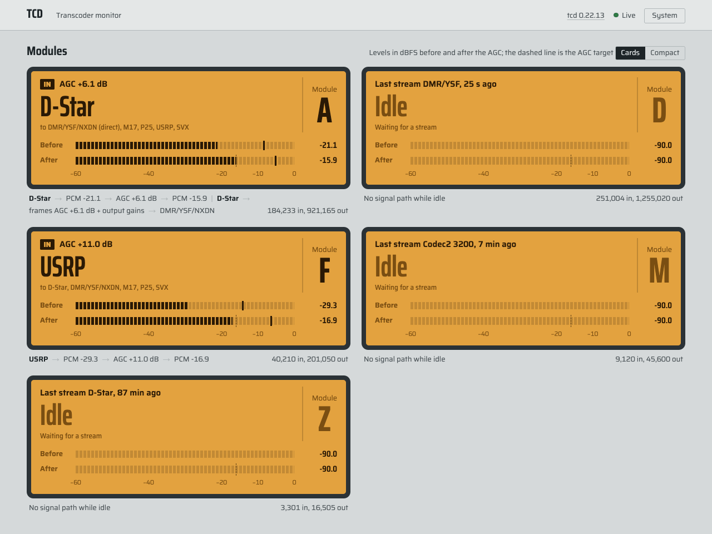
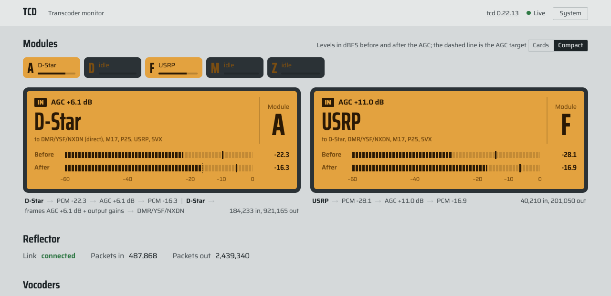
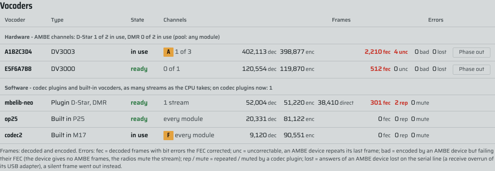
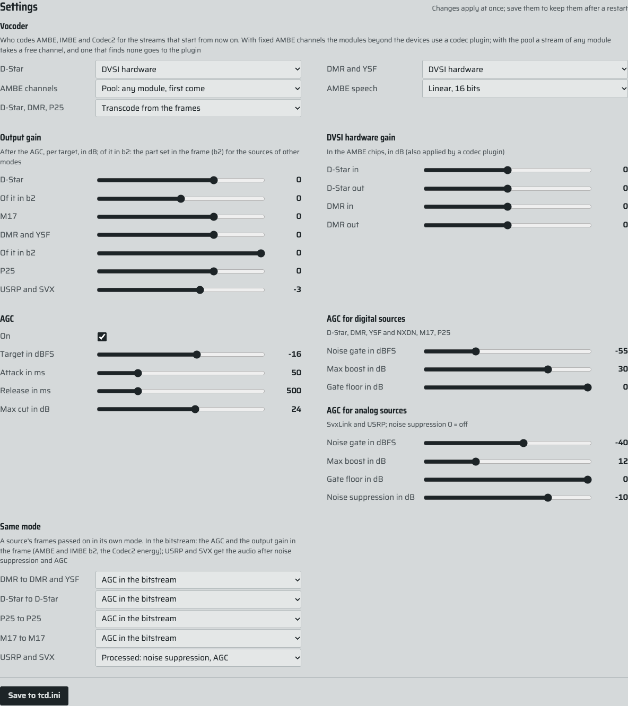

# tcd — Hybrid Digital Voice Transcoder

**English** | [Deutsch](README.de.md)

**Version 0.22.13** — the transcoder of [urfd-ng](../README.md), in the `tcd/` folder of the same repository. Based on [n7tae/tcd](https://github.com/n7tae/tcd). What changed from version to version is in the [release notes](https://github.com/jcmerg/urfd-ng/releases).

tcd converts voice between the digital modes on a URF reflector, so a D-Star user hears a DMR user and the other way round. The reflector hands the audio of its transcoded modules to tcd over TCP and gets every other mode back.

- **D-Star** (AMBE) and **DMR/YSF/NXDN** (AMBE2+) on DVSI AMBE hardware (DV3000, DV3003 and their relatives), or in software with a [codec plugin](#codec-plugins)
- **P25** (IMBE, also YSF VW) with tcd's own OP25 vocoder, **M17** with tcd's own Codec2; a codec plugin can take these too
- an **AGC** that brings every call to the same level, whatever radio or vocoder it came from, also DMR → DMR/YSF without re-encoding
- noise suppression for **analog sources** (SvxLink, AllStar)
- a **web dashboard** and the terminal monitor **tcdmon**, with live level meters and settings

<picture>
  <source media="(prefers-color-scheme: dark)" srcset="../docs/images/tcd-monitor-dark.png">
  
</picture>

*The tcd web dashboard (sample data): per module the input codec, its targets, the levels before and after the AGC and the signal path.*

## Contents

- [Install](#install)
- [Hardware](#hardware)
- [Codec plugins](#codec-plugins)
- [tcd in Docker](#tcd-in-docker)
- [Selecting the AMBE devices](#selecting-the-ambe-devices)
- [Configuration (tcd.ini)](#configuration-tcdini)
- [Audio levels](#audio-levels)
- [Monitoring](#monitoring)
- [Operation and troubleshooting](#operation-and-troubleshooting)
- [Changes from upstream](#changes-from-upstream)

The measurements and listening tests behind the defaults are in [docs/MEASUREMENTS.md](docs/MEASUREMENTS.md).

## Install

### With the setup script

The easiest way: the setup script in the repository root installs reflector and transcoder together, or the transcoder alone on a second machine, asks a few questions and writes `tcd.ini`. See [docs/INSTALL.md](../docs/INSTALL.md).

```bash
git clone https://github.com/jcmerg/urfd-ng.git urfd
cd urfd
sudo ./setup.sh
```

### With build.sh

To build and install only the transcoder:

```bash
git clone https://github.com/jcmerg/urfd-ng.git urfd
cd urfd
sudo bash tcd/build.sh
```

`build.sh` installs the build tools, `libspeexdsp-dev`, `libwebsockets-dev` and `libncurses-dev`, builds tcd as the owner of the checkout and installs `tcd`, `tcdmon`, `agc-analyze` and the systemd unit. A codec plugin in `tcd/plugins/<name>/` (a `git clone` of its repository, see [Codec plugins](#codec-plugins)) is built with it and installed to `/usr/local/lib/tcd/`. A running tcd is restarted. The first install puts the template at `/usr/local/etc/tcd.ini`; edit it (see [Configuration](#configuration-tcdini)) and start with `sudo systemctl start tcd`.

To update: `sudo ./setup.sh update` (it also pulls the plugin clones in `tcd/plugins/`), or by hand `git pull` in the checkout and in each plugin clone, then `build.sh` again.

### By hand

With `libspeexdsp-dev`, `libwebsockets-dev` and `libncurses-dev` installed:

```bash
cd urfd/tcd
make -j$(nproc)
sudo cp config/tcd.ini /usr/local/etc/tcd.ini   # first install only, then edit it
sudo make install
```

`make install` copies `tcd` and `tcdmon` to `/usr/local/bin` (`BINDIR` in `tcd.mk`, which also has `debug = true` for a build with gdb symbols) and installs and enables the systemd unit; it starts tcd only when `/usr/local/etc/tcd.ini` is there. Unlike `build.sh` it installs no `tcd.ini`, no `agc-analyze` and no codec plugin. Run `make` as yourself first: `make install` builds what is missing, as root then. `sudo make uninstall` stops and disables tcd and removes the unit, `tcd` and `tcdmon`.

Codec2 (`codec2/`) and the P25 IMBE vocoder from OP25 (`imbe/`) are part of the source, so no other library and no other repository is needed. tcd builds against the sources it shares with the reflector (`TCPacketDef.h`, `TCSocket.*`, ...) from `../reflector`, so both sides always speak the same protocol. `config/tcd.ini` is the commented template, `config/tcd.service` the systemd unit.

### macOS

tcd also builds and runs natively on macOS (Apple silicon or Intel), with the AMBE devices on USB; Docker Desktop cannot pass USB devices through. With the Xcode command line tools and [Homebrew](https://brew.sh):

```bash
brew install speexdsp libwebsockets
cd urfd/tcd
make -j$(sysctl -n hw.ncpu)
./tcd --list-devices
./tcd /path/to/tcd.ini        # Ctrl-C stops it
```

- macOS has no `/dev/serial/by-id`: tcd finds the USB serial ports (`/dev/cu.*`) through IOKit and names them as udev would (`usb-FTDI_DVstick-33_DKB7FXGE-if00-port0`), so device detection and `DeviceSerial` work as on Linux. Apple's own FTDI driver is used, no extra driver.
- tcd sets the FTDI latency timer to 1 ms there too; 460800 and 921600 baud are set through IOKit.
- `make install` and the systemd unit are for Linux; on macOS start tcd by hand (or with a launchd job). A codec plugin in `plugins/<name>/` builds the same way as on Linux.

### Requirements

- Linux with systemd: Debian, Ubuntu or Raspberry Pi OS; x86_64, arm64 or armhf; or macOS with Homebrew (see [macOS](#macos))
- DVSI AMBE USB devices (see [Hardware](#hardware)), or a codec plugin instead; the devices use the kernel's `ftdi_sio` driver, no extra driver needed
- `libspeexdsp-dev` (noise suppression of analog input) and `libwebsockets-dev` (web dashboard); `build.sh` installs them
- A Raspberry Pi 4 is plenty for a few modules. tcd sets the USB latency timer of the AMBE devices to 1 ms itself, natively and in Docker. It can run on the reflector's machine or on another one, e.g. a Raspberry Pi next to the radio gear.

## Hardware

Each transcoded module needs a D-Star channel and a DMR/YSF channel. A DV3000 (ThumbDV, DVstick-30, USB-3000) has one channel, a DV3003 (DVstick-33, USB-3003) three. A codec without a device can come from a [codec plugin](#codec-plugins).

| Hardware | Codec plugin | Modules | Notes |
|---|---|---|---|
| none | one for D-Star and DMR | any | everything in software |
| 1× DV3000 | one for DMR (or D-Star) | 1 | D-Star on the device, DMR/YSF in software |
| 1× DV3003 | one for DMR (or D-Star) | up to 3 | D-Star on the device, DMR/YSF in software |
| 1× DV3003 with `mixed` | one for D-Star and DMR | 1 on the device (plus the DMR of a 2nd), more in software | see [below](#single-dv3003-in-mixed-mode) |
| DV3000 + DV3003 | — | 2 | mixed mode, recommended |
| 2× DV3000 | — | 1 | one for D-Star, one for DMR/YSF |
| 2× DV3003 | — | up to 3 | one for D-Star, one for DMR/YSF |
| 3 devices and more (e.g. USB-3012) | for the modules beyond the channels | half the channels | see [below](#three-devices-and-more) |

A single device needs a codec plugin for the other codec; tcd refuses to start without one. With two devices no plugin is needed: [`DmrGainMode = ambe`](#dmrysf--dmrysf-level-dmrgainmode) gives DMR → DMR/YSF the AGC without re-encoding. tcd detects the devices and picks the mode itself. With more modules than channels, the devices take the first modules of `Modules` and the rest goes to a codec plugin (or use the [channel pool](#channel-pool-devicechannels--pool)).

### Mixed mode: DV3000 + DV3003

Two modules at once, with the channels assigned automatically:

| Channel | Use |
|---|---|
| DV3000 ch0 | D-Star, first module |
| DV3003 ch0 | D-Star, second module |
| DV3003 ch1 | DMR/YSF, first module |
| DV3003 ch2 | DMR/YSF, second module |

```ini
Modules = FS            # first = D-Star on the DV3000, second = D-Star on the DV3003
DeviceSerial = DQ015SBR # DV3000
DeviceSerial = DKB7FXGE # DV3003
```

### Single DV3003 in mixed mode

`mixed` after the serial of a DV3003 that is the only device sets its channels up as in mixed mode: channel 0 D-Star, channels 1 and 2 DMR/YSF. The first module (with the [pool](#channel-pool-devicechannels--pool): the first stream) is transcoded on the device in both directions, a second one gets its DMR on channel 2 and its D-Star on the codec plugin, the other modules go to the codec plugins (one for D-Star and DMR is needed). Without `mixed` a DV3003 alone does D-Star for three modules. `mixed` is only for a DV3003 alone with `CodecDStar`/`CodecDMR` on `dvsi`; anywhere else tcd warns and ignores it.

```ini
Modules = FSA
DeviceSerial = DKB7FXGE mixed   # F on the DV3003, the DMR of S on it too, the rest on the plugin
CodecPlugin = /usr/local/lib/tcd/mbelib_neo_codec.so
```

### Channel pool (`DeviceChannels = pool`)

By default the AMBE channels belong to the first modules of `Modules`. With `DeviceChannels = pool` a stream takes any free channel when it starts, whatever its module, and keeps it until its last frame (or 1.5 s without one); a stream that finds no free channel goes to a codec plugin. D-Star and DMR are pools of their own. So the devices serve the modules that are busy right now: with DV3000 + DV3003 the first two streams on any modules run on the devices, a third at the same time in software. The same module can then sound different from one transmission to the next (device or plugin). The [web dashboard](#web-dashboard) switches between fixed and pool at run time for new streams; Save writes it to `tcd.ini`.

### A device lost while tcd runs

A device that is unplugged, or that leaves a packet unanswered for 1 s (a hung chip), is taken out: its streams, also the ones on the air, go to a codec plugin, and tcd opens the device again as soon as it is back (looked for every 5 s by its `/dev/serial/by-id` name, so a replug may give it another node). New streams use it again from then on. Without a plugin for one of the device's codecs tcd stops instead; systemd (or Docker) restarts it, or a [standby tcd](#standby-a-second-tcd-for-the-same-modules) takes the modules. A device missing at the start is only used after the next start of tcd.

### Lost answers (`DeviceCompand`)

The USB adapter of a DV3003 at 921600 baud drops a byte now and then, when the computer fetches its receive buffer a few milliseconds late (the kernel counts an `overrun` on the tty). Measured on a Raspberry Pi 5: about one in 30 000 to 60 000 answers, only decoder answers (327 bytes of audio each); never with a DV3000 at 460800 baud.

tcd resynchronises on the next answer, so a dropped byte costs at most one frame: 20 ms of silence for that frame (logged as `... was lost (...), a silent frame instead`). An answer lost together with its header leaves its channel one frame behind until the stream ends. The monitor counts these per device (`lost`, and `lost:` in tcdmon).

`DeviceCompand = ulaw` (or `alaw`) removes the overruns: the devices send the audio as 8-bit G.711 instead of 16-bit linear, half the bytes, and tcd converts it right when it reads it. The difference cannot be heard behind the AMBE codec (PESQ within 0.03 of linear, see [measurements](docs/MEASUREMENTS.md#lost-answers-on-the-dv3003-and-devicecompand)). The default stays `linear`, as DVSI recommends; turn it on when the monitor shows lost answers. The web dashboard switches it at run time (`AMBE speech`): each device is opened again with the new setting once its streams are done, a codec plugin or another device takes new streams meanwhile. Save writes it to `tcd.ini`.

### Single device with a codec plugin

One module, D-Star on the DV3000 or DV3003 and DMR/YSF through a codec plugin. DMR/YSF → DMR/YSF audio is then **not re-encoded** after the AGC; its level follows the AGC through the bitstream gain (`DmrGainMode = ambe`). All paths between different modes get the full AGC. Re-encoding DMR/YSF → DMR/YSF needs a second AMBE device.

### Three devices and more

With three devices or more (several DV3003, a DV3000 next to them, or boards with four AMBE3003 chips like the USB-3012, which show up as four DV3003) tcd uses every channel of every device and gives them D-Star and DMR in turn, so a pair mostly sits on one chip. Each transmission needs one channel of each codec, so the devices handle half as many transmissions at once as they have channels: 2× DV3003 three, a USB-3012 six. The DV3003s come first, ordered by name, so the modules keep their channels from start to start as long as the same devices answer. At most 16 devices are used. With `CodecDStar` or `CodecDMR` on a codec plugin every device does the other codec on all its channels. The log names the split at start (`4 AMBE devices, 12 channels: 6 for D-Star, 6 for DMR`).

**Hardware and software channels**: the AMBE channels are a fixed number; codec plugins and tcd's own vocoders (OP25, Codec2) take as many streams as the CPU allows. The monitor shows both apart.

### DV3003 notes

- **Companding**: every channel of every device gets companding set as `DeviceCompand` says (linear by default), and tcd checks the answer. Without it, a chip follows its board's CP_ENABLE pin after a reset (the DVstick-33 pulls it up to µ-law), and µ-law audio read as linear is distorted.
- **Serial flush**: before the soft reset, 350 zero bytes clear any stale serial state.
- **Per-channel codec**: one DV3003 can run D-Star and DMR/YSF channels at the same time (mixed mode).

## Codec plugins

A codec plugin is a shared object that brings D-Star (AMBE), DMR/YSF (AMBE2+), P25 (IMBE) and/or M17 (Codec2) in software. tcd loads it at start:

```ini
CodecPlugin = op25                        # tcd's own P25 vocoder
CodecPlugin = codec2                      # tcd's own M17 vocoder, Codec2 3200 and 1600
CodecPlugin = /usr/local/lib/tcd/foo.so   # as many lines as needed
CodecDStar  = dvsi                        # the vocoder new D-Star streams get: dvsi or a plugin's name
CodecDMR    = foo                         # the same for DMR/YSF
CodecP25    = op25                        # P25: op25 (the default when loaded) or a plugin's name
CodecM17    = codec2                      # M17: codec2 (the default when loaded) or a plugin's name
```

No codec plugin is part of this repository: software implementations of AMBE and AMBE2+ may touch patents (AMBE2+ half rate, US 8,359,197, projected to run until 2028-05-20), so whether to build and use one is the operator's decision. A plugin for D-Star, DMR/YSF and P25 based on [mbelib-neo](https://github.com/arancormonk/mbelib-neo) is [tcd-mbelib-neo-plugin](https://github.com/jcmerg/tcd-mbelib-neo-plugin); read its patent notice first. Put its clone in `tcd/plugins/<name>/`, and `build.sh`, `setup.sh` and the Docker image build it with tcd (see [plugins/README.md](plugins/README.md)).

- **tcd's own vocoders**: OP25 for P25 and Codec2 for M17 are built into tcd and loaded like a plugin, by a `CodecPlugin` line with their name instead of a path. Without its line tcd's own is still loaded, unless `CodecP25` / `CodecM17` names a plugin that does the codec. To leave OP25 or Codec2 out, drop the line and name the plugin there. Save in the monitor writes the lines of the ones loaded. (A `tcd.ini` with these two lines needs tcd 0.22.0 or later.)
- **Which vocoder**: without `CodecDStar`/`CodecDMR` the devices come first and a plugin only does what no device does. A plugin's name there puts that codec in software from the start; with a single device the device then takes the other codec. A vocoder named in `CodecP25`/`CodecM17` that is not loaded or lacks the codec stops tcd. A plugin chosen for M17 without Codec2 1600 leaves M17 voice+data streams to `codec2`.
- **More modules than channels**: the devices take the first modules of `Modules`, the others go to a plugin. With DV3000 + DV3003 and `Modules = FSABC`, F and S are transcoded on the devices and A, B and C in software. Without a plugin for the rest, tcd does not start.
- **Switching at run time**: the web dashboard (settings, "Vocoder") and `POST /api/codec` with `{"codec": "dstar", "use": "foo"}` (`dstar`, `dmr`, `p25` or `m17`) choose the vocoder for the streams that start from then on; a running transmission keeps its vocoder. "Save" writes the choice to `tcd.ini`.
- **Direct transcoding** (`Transcode = direct`, the default): when a stream comes in as D-Star, DMR/YSF or P25 and another of the three goes out, both on the same plugin, and the plugin supports it, the plugin codes the outgoing frame straight from the vocoder parameters of the incoming one instead of decoding to audio and encoding again. The three share the MBE vocoder model, and the second analysis of synthesized speech is what a transcoder loses most to: measured over 19 clips every direction gains 0.09 to 0.24 PESQ, at a fifth of the processing time ([measurements](docs/MEASUREMENTS.md#direct-transcoding)). The AGC's gain and the output gains go into the frame's parameters. M17, USRP, SVX and every target on an AMBE device or another vocoder still get the decoded audio. A transmission joins the direct path only from its first frame and stays on the audio path once it left it. The monitor marks directly coded targets "direct". `Transcode = audio` turns it off; the web dashboard switches it at run time.
- **Options**: lines of `tcd.ini` that tcd does not know go to the plugins, e.g. a path the plugin needs; a line nobody takes is warned about.
- **P25 and YSF VW**: urfd hands YSF VW (IMBE) to tcd as P25, so `CodecP25` also decodes VW; the monitor calls the codec IMBE (P25, YSF VW).

### Writing a plugin

The interface is plain C, [`CodecPlugin.h`](CodecPlugin.h): `open`/`close` a state per stream, `encode`/`decode` 160 samples of 8 kHz PCM to and from a frame, `start`/`stop` at the first and after the last frame of a transmission; optionally `decode_info` (how a frame came out: corrected bit errors, repeat, mute, tone, silence), `frame_format` and `transcode` for the direct path. tcd closes the state of a stream that has been quiet for 30 s. It calls a plugin from one thread at a time, unless the plugin sets `TCD_PLUGIN_CONCURRENT` (API 5): then the [module workers](#module-workers) call it at the same time on the states of different streams, never on one state at once. A plugin is built against this header only and loads into newer tcd versions as long as its API version is within `TCD_CODEC_API_MIN` to `TCD_CODEC_API`.

Frame formats: D-Star as the 9 data bytes of a DV frame, DMR/YSF as the 72 bits of an AMBE2+ frame in air order, MSB first (the formats of the DVSI devices); P25 as the 88 IMBE parameter bits u0..u7 in 11 bytes, MSB first; M17 as the 64 Codec2 bits of 20 ms (3200) or 40 ms (1600, 320 samples). tcd encodes M17 as 3200 only.

`tools/` has test tools (`make` there):

- `codectest <plugin.so> dmr|dstar|p25 in.raw out.frames out.raw [option=value ...]`: encodes and decodes 8 kHz s16le PCM, prints the time per frame and checks that two interleaved streams stay apart; `codectest <plugin.so> dstar:dmr ...` (any two of `dstar`, `dmr`, `p25`) tests `transcode`
- `decode`: decodes a frames file
- `dvsitest <device> enc|dec dstar|dmr in out`: the same on a DV3003 (`DVSI_TYPE=3000` for a DV3000), to compare a plugin with the hardware; `dvsitest <device> info` prints the chip's product ID and version; `dvsitest <device> batch <jobs>` runs a job list on the three channels of a DV3003. Stop tcd first, or phase the device out in the monitor.
- `ambecheck`: checks the FEC of a file of AMBE frames

### Module workers

Each module belongs to one of tcd's workers (`Workers` in tcd.ini, `auto`: one per CPU core tcd may use, in Docker within its `--cpus` / `--cpuset-cpus`). The worker does everything for its module's frames, one codec after the other: decoding, AGC, encoding to the other codecs in software, the AMBE devices' answers and sending the frames back to urfd. Workers run at the same time, so the modules share the CPU cores and a module that takes long does not hold up the modules of other workers. The modules are dealt out in turn in the order of `Modules` and `StandbyModules`; the log names the split at start (`4 module workers: AE BF CG DH`).

The AMBE devices keep their own threads for the serial line; a worker hands them a frame and goes on with other frames meanwhile. tcd's own vocoders (OP25, Codec2) run in parallel; a codec plugin does when it sets `TCD_PLUGIN_CONCURRENT` (API 5), otherwise one worker at a time uses it and the log says so at start. Measured on a Raspberry Pi 5: 26 modules transcoding at the same time in all protocols take less than half of one core ([measurements](docs/MEASUREMENTS.md#cpu-load-and-latency)).

## tcd in Docker

tcd runs in a container just as well, next to urfd or on a machine of its own: with AMBE sticks, or in software with a [codec plugin](#codec-plugins) for D-Star and DMR. `setup.sh` asks whether tcd runs in Docker or natively with systemd.

By hand, with the configuration in `$URFD_DATA/tcd/tcd.ini` (default `/opt/urfd/tcd`):

```bash
cd ~/urfd
# only for software D-Star/DMR: the codec plugin, read its patent notice first
git clone https://github.com/jcmerg/tcd-mbelib-neo-plugin.git tcd/plugins/mbelib-neo
sudo mkdir -p /opt/urfd/tcd && sudo cp tcd/config/tcd.ini /opt/urfd/tcd/tcd.ini
sudo nano /opt/urfd/tcd/tcd.ini
sudo docker/build.sh start
```

`docker/build.sh` builds and starts what this machine has a configuration for: urfd with `$URFD_DATA/config/urfd.ini`, tcd with `$URFD_DATA/tcd/tcd.ini`, so it also serves a machine with only tcd. A `tcd.ini` with a `DeviceSerial` other than `none`, or without a codec plugin (a `CodecPlugin` line other than `op25` and `codec2`), means AMBE sticks: the container then gets the host's `/dev` read only and the USB serial devices (`docker/docker-compose.tcd-sticks.yml`). tcd finds the sticks by `/dev/serial/by-id` as natively and sets their USB latency timer itself. Inside the container: `docker exec -it tcd tcdmon`.

In `tcd.ini`: `ServerAddress = 127.0.0.1` next to urfd (the container uses the host's network), else the reflector's address; with sticks `DeviceSerial` as natively, in software `CodecPlugin = /usr/local/lib/tcd/mbelib_neo_codec.so` and no `DeviceSerial`; a `MonitorHttpPort` that is free on the host. In `urfd.ini`: `[Transcoder] Modules = auto`, so tcd's list alone decides. The image builds every `tcd/plugins/<name>/` with a `Makefile`; `tcd.ini` is writable for the monitor's Save. To update: `sudo ./setup.sh update`, or by hand `git pull` in the checkout and in each plugin clone, then `docker/build.sh`. The images are built locally, so the containers carry a label that keeps watchtower away.

Next to urfd, the urfd container's nginx passes `/tcd/` to the monitor, so it is reachable as `https://<reflector>/tcd/` through the TLS proxy in front (pass `/tcd/` with the same Upgrade headers as `/ws`, `X-Real-IP` and `X-Forwarded-Proto`). `docker/build.sh` reads the port from `MonitorHttpPort` and hands it to the urfd container as `TCD_MONITOR_PORT` (default 8080; with `docker compose` by hand, set it in the environment). `MonitorBindAddress = 127.0.0.1` is enough then; set `MonitorPassword`.

### Standby: a second tcd for the same modules

`StandbyModules` lists modules a tcd takes only while no other tcd has them: e.g. a software tcd in Docker next to urfd stands by for the modules of the tcd with the sticks, takes them over when that one is gone and gives them back when it returns.

```ini
# tcd in Docker next to urfd, with the mbelib-neo plugin
Modules        = AP      # its own modules
StandbyModules = FS      # the modules of the tcd with the sticks, while it is gone
```

The reflector gives a standby connection only a module without a tcd, and a normal connection replaces a standby one; the standby tcd asks again every 3 s. A tcd that stops or loses its link hands over within seconds; one that vanished without closing its connection (power, network) is noticed after about 25 s (TCP keepalive), one that froze after 20 s without its pings. A stream on the air while a module changes hands is not transcoded until its next transmission. urfd needs `[Transcoder] Modules = auto` (or the letters listed there).

## Selecting the AMBE devices

```bash
tcd --list-devices
```

lists the USB serial devices from `/dev/serial/by-id` (on macOS from IOKit) with their serial numbers and marks the ones that look like AMBE devices.

Without `DeviceSerial` in `tcd.ini`, tcd uses every device named as a DVSI one: ThumbDV, DVstick-30, DVstick-33, USB-3000, USB-3003, USB-3006, USB-3012 and the DF2ET boards. A clone with the generic FTDI name `FT232R_USB_UART` or `FT230X_Basic_UART` is only used with its `DeviceSerial`, since every other FTDI adapter (programming and CAT cables, GPS) has that name too; tcd logs such a device with the line to add. `DeviceSerial = none` uses no AMBE device at all, even with sticks plugged in. `DeviceSerial` must match exactly one of:

- the USB serial number (`DKB7FXGE`)
- the older libftd2xx form with the port letter of multi-port devices (`DA1234A`)
- the `/dev/serial/by-id` name
- the device node (`/dev/ttyUSB0`)

tcd opens the devices through the kernel's `ftdi_sio` driver (no libftd2xx needed) and sets their USB latency timer to 1 ms (the driver default of 16 ms is too slow; the log shows the value). Devices an older, libftd2xx based tcd left unbound from `ftdi_sio` are bound back at start.

Whether a device is a DV3000 (one channel) or a DV3003 (three) tcd takes from the product ID its chip reports, not from the USB name, which clones often leave generic. The baud rate follows the name: 460800 for the single channel sticks (ThumbDV, DVstick-30, USB-3000 and the generic FTDI names), 921600 for the others. tcd never tries another rate: bytes at a wrong rate can leave an AMBE3003 deaf until it is replugged.

A device that cannot be opened or does not answer is left out with a warning, and tcd carries on with the others and the codec plugins, as long as they cover the modules. Each device is opened for tcd alone: a second tcd or `dvsitest` gets `is in use by another process`.

## Configuration (tcd.ini)

`/usr/local/etc/tcd.ini`; the template in [`config/tcd.ini`](config/tcd.ini) explains every key. Restart tcd after changes (`sudo systemctl restart tcd`), or change the audio settings live in the [web dashboard](#web-dashboard).

### Connection and devices

| Key | Template | Meaning |
|---|---|---|
| `ServerAddress` | `127.0.0.1` | IP address or host name of the urfd reflector (resolved again on every reconnect) |
| `Port` | `10100` | the reflector's `[Transcoder] Port` (1025-49000) |
| `Password` | — | the reflector's `[Transcoder] Password`, needed when it has one; the setup script generates it |
| `Modules` | `FS` | transcoded modules; with the reflector's `[Transcoder] Modules = auto` this list alone decides, else the same letters as there |
| `StandbyModules` | — | modules this tcd takes only while no other tcd has them, see [Standby](#standby-a-second-tcd-for-the-same-modules); not in `Modules` as well |
| `DeviceSerial` | — | AMBE device to use, one line each (see [above](#selecting-the-ambe-devices)), `none` for none; `mixed` after the serial of a lone DV3003, see [Single DV3003 in mixed mode](#single-dv3003-in-mixed-mode) |
| `CodecPlugin` | `op25`, `codec2` | codec plugin to load, one line each: the path of a shared object, or `op25` / `codec2` for tcd's own (see [Codec plugins](#codec-plugins)) |
| `CodecDStar` / `CodecDMR` / `CodecP25` / `CodecM17` | — | the vocoder new streams get: `dvsi`, `op25`, `codec2` or a plugin's name; written by Save |
| `Transcode` | `direct` | `direct`: D-Star, DMR/YSF and P25 coded into each other from the vocoder parameters where a plugin can; `audio`: every codec from the decoded audio (see [Codec plugins](#codec-plugins)) |
| `Workers` | `auto` | the threads that code the modules, each module on one of them; `auto`: one per CPU core, at most one per module; or 1 to 26 (see [Module workers](#module-workers)) |
| `DeviceChannels` | — (default `fixed`) | `fixed`: the AMBE channels belong to the first modules; `pool`: a stream takes any free channel (see [Channel pool](#channel-pool-devicechannels--pool)) |
| `DeviceCompand` | — (default `linear`) | audio to and from the AMBE devices: `linear` (16 bits), `ulaw` or `alaw` (8-bit G.711, see [Lost answers](#lost-answers-devicecompand)); written by Save |

### Gains

All gains are in dB, -40 to +40 (the web dashboard's sliders: output gains -24 to +10, the DVSI gains -24 to +24).

| Key | Template | Applied to |
|---|---|---|
| `OutputGainDStar` | `0` | D-Star output, after the AGC |
| `OutputGainDMR` | `-14` | DMR/YSF output, after the AGC; every path to DMR/YSF, including DMR → DMR/YSF |
| `OutputGainDMRBitstream` | `-6` | -24 to 0: how much of `OutputGainDMR` is applied inside the AMBE2+ frame (b2) after the encoder instead of as PCM before it, for D-Star, M17, P25, USRP and SVX sources; see below. Not used on the direct path |
| `OutputGainM17` | `0` | M17/Codec2 output, after the AGC |
| `OutputGainIMBE` | `0` | P25 output, after the AGC |
| `OutputGainUSRP` | `0` | USRP and SVX output, after the AGC (both get the same PCM from tcd) |
| `DStarGainIn` / `DStarGainOut` | `0` | inside the DVSI chip, D-Star decode / encode; for a codec plugin tcd applies them in software |
| `DmrGainIn` / `DmrGainOut` | `0` | inside the DVSI chip, DMR decode / encode; for a codec plugin tcd applies them in software |

SVX and USRP gains per connection are set in the reflector's `urfd.ini` (`RxGain`/`TxGain` in `[SvxReflector]`, `[SVXServer]` and `[USRP]`).

DMR radios expect a lower level than the AGC target (-16 dBFS): `OutputGainDMR = -14` brings every path to DMR/YSF down to about -30 dBFS, the level of speech on BrandMeister. With all of that as PCM gain, the AMBE2+ encoder would get the other codecs' audio far below the level it is made for. `OutputGainDMRBitstream` moves part of it behind the encoder into the frame's gain parameter. Keep it small: b2 moves quiet frames only in coarse steps, so large values bring artifacts on quiet syllables; -4 to -6 sound clean, -6 is the default ([measurements](docs/MEASUREMENTS.md#outputgaindmrbitstream)).

### DMR/YSF → DMR/YSF level (`DmrGainMode`)

DMR to DMR/YSF audio normally passes through as AMBE2+ without being decoded, so the AGC cannot touch it. `DmrGainMode` decides how its level is adjusted:

| Mode | Needs | What it does |
|---|---|---|
| `off` | — | no adjustment |
| `ambe` | — | the default: applies the AGC's gain plus `AmbeGainDb` (-30 to +10 dB) and `OutputGainDMR` through the b2 (delta-gamma) gain parameter in the AMBE2+ frame. No re-encode, no quality loss, also repairs Golay FEC errors |
| `reencode` | a DMR codec plugin and a DMR device | full decode and re-encode through the codec plugin, with AGC and `DmrReencodeGain`; same level as `ambe` with the same value. Falls back to `ambe` without a DMR codec plugin |

| Key | Template | Code default |
|---|---|---|
| `DmrGainMode` | `ambe` | `ambe` |
| `AmbeGainDb` | `0` | `0` |
| `DmrReencodeGain` | `0` | `0` |

`AmbeGainDb` and `DmrReencodeGain` only move DMR → DMR/YSF against the other paths and normally stay 0.

How `ambe` works: the decoder computes γ = Δγ[b2] + 0.5·γ<sub>prev</sub>, and a frame's mean log2 amplitude is γ, so one unit of γ is 6 dB. The Δγ table is coarse for low b2 and fine for high b2. tcd tracks γ for the original and the modified stream and chooses, frame by frame, the b2 that comes closest to the wanted gain; the rounding error is made up in the next frame. So the gain does not depend on the level: gains of -12 to +6 dB arrive within 0.8 dB on input at -40 to -16 dBFS. Very quiet sources cannot be raised beyond what b2 = 31 allows.

### AGC

| Key | Template | Code default | Meaning |
|---|---|---|---|
| `AGC` | `true` | `false` | automatic gain control on/off |
| `AGCTarget` | `-16` | `-16` | target level in dBFS |
| `AGCAttack` | `50` | `50` | time constant in ms for rises of the speech level up to 10 dB (larger jumps are caught within 2–3 frames) |
| `AGCRelease` | `500` | `500` | time constant in ms for falls of the speech level, applied only on clearly voiced speech well above the noise floor |
| `AGCMaxGainDown` | `24` | `24` | most attenuation in dB |

Gate and gain limit come in two profiles: **AGC digital** for D-Star, DMR/YSF/NXDN, M17 and P25 input, **AGC analog** for SVX and USRP input.

| Key | Template | Code default | Meaning |
|---|---|---|---|
| `AGCDigitalNoiseGate` / `AGCAnalogNoiseGate` | `-55` / `-40` | `-55` / `-40` | gate threshold in dBFS: frames below it, or less than 9 dB above the noise floor tcd measures per stream, count as no speech; 240 ms later the gate closes and fades the gain to the gate floor |
| `AGCDigitalMaxGainUp` / `AGCAnalogMaxGainUp` | `30` / `12` | `30` / `12` | most amplification in dB |
| `AGCDigitalGateFloor` / `AGCAnalogGateFloor` | `0` / `0` | `0` / `0` | gain while the gate is closed, in dB (0 = unity, at most) |
| `AGCAnalogNoiseSuppress` | `-10` | `-10` | SVX and USRP only: most attenuation of the noise by the speexdsp preprocessor before the AGC, in dB (-40 to 0, 0 = off) |

**Analog sources (SVX, USRP)** carry FM audio, whose pauses are not silent but the receiver's noise, often -45 to -35 dBFS. With the settings for digital sources the AGC would raise that noise between words by up to 30 dB. AGC analog has its own gate, gain limit and gate floor, so the speech stays well above the noise (on recorded FM-Funknetz traffic 32 dB speech-to-noise instead of 19, see [measurements](docs/MEASUREMENTS.md#agc-on-analog-sources)). The gate works on the level after urfd's `RxGain`, so keep that near 0 and let the AGC set the level. A squelch tail is louder than any gate: `SQL_TAIL_ELIM` in the SvxLink node's receiver removes it at the source.

**Noise suppression** (`AGCAnalogNoiseSuppress`): the gate only works between words; the FM noise under the speech stays, and the vocoders, AMBE above all, turn it into a warbling, robotic sound. So SVX and USRP input first goes through the speexdsp preprocessor, without added delay, with one noise estimate per module. Its own AGC, VAD and dereverb are off. -10 dB keeps a quiet, natural noise floor and whole syllables; stronger values remove more noise but cut syllable onsets and leave "musical" artifacts. Live in the monitor, 0 switches it off. The AMBE chip's own noise suppressor is switched off by tcd: it would act on every codec that channel encodes, also on clean digital audio.

### Monitoring and logging

| Key | Template | Meaning |
|---|---|---|
| `Monitor` | `true` | web dashboard and stats socket on/off |
| `MonitorBindAddress` | `127.0.0.1` | address of web dashboard and stats socket; `0.0.0.0` opens them to the network (then set `MonitorPassword`: the page can change and save levels) |
| `MonitorView` | `auto` | `cards`, `compact` or `auto` (compact from five modules on); written by Save |
| `MonitorPassword` | (none) | the page asks for it and keeps a session cookie for 30 days (5 failed logins from one address pause logins from there for 60 s); also `tcdmon` from other hosts than 127.0.0.1 (it asks, or takes `TCD_MONITOR_PASSWORD`). Plain HTTP: from outside the LAN use a TLS proxy or an ssh tunnel |
| `MonitorHttpPort` | `8080` | web dashboard |
| `MonitorStatsPort` | `8081` | stats socket (JSON, for `tcdmon`) |
| `StatsLog` | `false` | per-stream CSV files for AGC tuning |
| `StatsLogDir` | `/tmp/tcd-stats` | where they go |
| `StatsLogRetain` | `24` | hours before they are deleted (1 to 8760) |
| `StreamLog` | `true` | one log line per stream at its end: frames, duration and the vocoder of every codec, with the FEC result on an AMBE device |

## Audio levels

Every conversion goes through PCM, except the direct path between the MBE codecs of one codec plugin:

```
D-Star/DMR (DVSI hardware):
  AMBE --[DVSI GainIn]--> PCM --[AGC]--> PCM --[OutputGain]--> [DVSI GainOut] --> target AMBE

M17/P25 (software vocoder):
  codec --[decode]--> PCM --[AGC]--> PCM --[OutputGain]--> target codec

USRP/SVX (PCM):
  PCM --[noise suppression]--> PCM --[analog AGC]--> PCM --[OutputGain]--> target codec   (RxGain/TxGain per connection in urfd.ini)

DMR -> DMR/YSF with DmrGainMode = reencode:
  AMBE2+ --[decode]--> PCM --[AGC]--> PCM --[OutputGainDMR]--> [DmrReencodeGain] --> codec plugin --> AMBE2+

DMR -> DMR/YSF with DmrGainMode = ambe:
  AMBE2+ --[decode]--> PCM --[AGC] (gain only)
  AMBE2+ --[b2: AGC gain + AmbeGainDb + OutputGainDMR]--> AMBE2+

D-Star, DMR/YSF, P25 -> another of the three, both on one plugin with transcode (Transcode = direct):
  frame --[decode]--> PCM --[AGC] (gain only)                       (M17, USRP, SVX get this PCM)
  frame --[plugin: AGC gain + OutputGain + DVSI-style GainIn/Out in the parameters]--> target frame
```

**With the AGC**, the static gains can usually all stay at 0, except `OutputGainDMR = -14` for the level DMR radios expect: it evens out different microphones, radios and codecs per transmission. Without it, every route needs its own static gain. D-Star → D-Star, M17 → M17 and P25 → P25 pass through unchanged.

The AGC works per stream (per transmission):
- a 75 Hz high-pass on the audio, so DC and hum neither drive the level nor reach the encoder
- the speech level follows the upper envelope of the speech, close to the vowels; noise floor, gate and voice detection look only at the band above 300 Hz, so a CTCSS tone or hum does not count
- rises are followed quickly; the level only falls (the gain only rises) on clearly voiced frames well above the noise floor, so breath, hiss and pauses do not make the gain pump
- the first voiced frames of a stream set its level fast, so the first words of a quiet speaker are not too quiet
- a noise floor per stream: weak, noisy signals are not lifted into their noise, clean sources get the full gain
- a noise gate that bridges the gaps between words (240 ms) and then fades the gain to the gate floor, so word endings stay and noise is not amplified
- the gain ramps sample by sample across each frame, and a peak limiter just below full scale keeps it from clipping

The gain limits are asymmetric on purpose: attenuating is safe, amplifying also lifts noise. Typical DMR input sits around -35 dBFS, so about +20 dB are needed to reach a -16 dBFS target.

## Monitoring

### Report of each transmission to urfd

After every transmission tcd tells urfd how it sounded: the level and peak before the AGC, the share of speech frames at -1 dBFS or more (overdriven), the level after the AGC and the AGC's gain, the FEC of the incoming AMBE frames and, decoded by a codec plugin, the frames it repeated or muted. The urfd dashboard shows it in the last heard list, so a station sees whether it overdrives. The format is `STCReport` in `reflector/TCPacketDef.h`, the fields in [docs/WEBSOCKET.md](../docs/WEBSOCKET.md#user_report).

### Web dashboard

`http://localhost:8080` on the tcd machine, from elsewhere through `ssh -L 8080:localhost:8080 <tcd-host>`, or `http://<tcd-host>:8080` with `MonitorBindAddress = 0.0.0.0`. Behind a reverse proxy it also works under a path, e.g. `https://<host>/tcd/` (see [tcd in Docker](#tcd-in-docker)).

- an LCD card per module with the input codec, the targets, level meters before and after the AGC (with peak hold and the AGC target) and the signal path with the level at each stage; targets coded directly are marked "direct"
- a compact view for many modules (from five on, or with "Compact"): a key per module, full cards only for the modules on the air and the ones pinned
- AGC and gain controls that apply immediately, and Save to write them to `tcd.ini`
- the vocoders: the AMBE channels in use (fixed or pool), each device with its serial, type, channels and modules, each codec plugin and tcd's own vocoders, with their frames and errors (`fec` corrected, `unc` uncorrectable, `bad` encoded frames failing their FEC, `rep`/`mute` repeated/muted by a plugin, `lost` answers lost on the serial line)
- "Phase out" takes a device out of service (the streams on it run to their end, then it can be unplugged), "Take back" opens it again; only for a device whose codecs a codec plugin covers
- the vocoder for new D-Star, DMR, P25 and M17 streams, "AMBE channels" (fixed or pool), "AMBE speech" (`DeviceCompand`) and direct transcoding, switchable at run time
- the reflector connection with its packet counters; a standby module shows "standby" or "taken over"
- light and dark theme; the page loads nothing from outside

<details>
<summary>More screenshots: compact view, vocoders, settings</summary>

Compact view: a key per module, cards only for the modules on the air.



Vocoders: AMBE devices and codec plugins with their frames and errors.



Settings: vocoder choice, gains and AGC, saved to tcd.ini.



</details>

### tcdmon

Terminal monitor, handy over SSH:

```bash
tcdmon                      # this machine, the MonitorStatsPort of its tcd.ini (else 8081)
tcdmon 192.0.2.20 8081      # another machine
```

Without a port tcdmon takes `MonitorStatsPort` from this machine's `tcd.ini` (`$TCD_INI`, `/usr/local/etc/tcd/tcd.ini` in the Docker image, or `/usr/local/etc/tcd.ini`), else 8081. It shows a card with level bars and signal flow for each module on the air and the others in one line, the AGC state, the AMBE devices and the codec plugins, and the output gains. `q` quits.

### Stats CSV and agc-analyze

With `StatsLog = true`, tcd writes one CSV file per stream to `StatsLogDir` (e.g. `F_20260402_003512_43521.csv`, columns `ms,module,codec,rms_in,peak_in,rms_out,peak_out,agc_gain,gate`). `agc-analyze` evaluates them:

```bash
agc-analyze               # details, default directory /tmp/tcd-stats
agc-analyze -s            # one line per stream
agc-analyze -s -c dmr     # by codec: dstar, dmr, p25, usrp, svx
agc-analyze -s -m F       # by module
agc-analyze file.csv      # one file
```

It shows duration, speech and gated frames, input and output level, the AGC gain range, clipping and gate flicker per stream.

## Operation and troubleshooting

```bash
sudo systemctl status tcd
sudo systemctl restart tcd
journalctl -u tcd -f
```

| Symptom | Check |
|---|---|
| `Could not find an AMBE device!` | `tcd --list-devices`; with `DeviceSerial` set, it must match exactly (see [above](#selecting-the-ambe-devices)) |
| `No USB serial devices found` | no device is plugged in, or the `ftdi_sio` driver is missing (`lsmod \| grep ftdi_sio`) |
| `USB latency timer is 16 ms` warning | tcd could not set the latency timer; natively it has to run as root (the systemd unit does); in Docker set `/sys/bus/usb-serial/devices/<tty>/latency_timer` to 1 on the host |
| `... does not answer at ... baud and is left out` | tcd runs with the other devices; unplug it and plug it in again, then restart tcd. A DV3003 with a generic USB name gets 460800 baud and cannot answer |
| `... is in use by another process` | another tcd or `dvsitest` holds the device: stop it (`pgrep -a tcd`) |
| `Lost the AMBE device ...` / `... has not answered for 1000 ms` | the device was unplugged, reset or hung; a codec plugin takes its streams and tcd opens it again when it is back (`... is back on ...`). Without a plugin tcd stops and systemd restarts it after 5 s |
| `... does not open or answer, trying again every 5 s` | a lost device is there but does not answer: unplug it and plug it in again |
| `Stream 0x78aa module A: 201 frames in 4.0 s; D-Star in DV3003 ttyUSB8 ch0 ok; DMR out DV3003 ttyUSB8 ch1 ok; P25 out OP25; M17 out <plugin>` | `StreamLog`: for every codec `in` (decoded) or `out` (encoded) and the vocoder. On an AMBE device `ok`, or `fec 12 unc 3` (12 frames with bit errors corrected, 3 uncorrectable, which the device repeats) and `bad 201` for encoded frames that fail their FEC (the radios mute them: phase the device out and take it back, or replug it). `then ...` notes a vocoder change mid-stream, `(no last frame)` a stream whose last frame did not come |
| `... the answer for module D stream 0x4c00 frame 812 was lost (...), a silent frame instead` | a byte of a device's answer was dropped on the serial line, see [Lost answers](#lost-answers-devicecompand); now and then is normal at 921600 baud with `DeviceCompand = linear`, `ulaw` takes it away |
| `... an answer without its start byte, taken` / `... N bytes that are no answer skipped` | the same; the answer was used all the same / its channel is one frame behind until the stream ends |
| the reflector shows no transcoder | `ServerAddress`, `Port` and `Password` in `tcd.ini`, the same `Modules` on both sides (or `[Transcoder] Modules = auto`), and port 10100/tcp reachable from the tcd machine |

## Changes from upstream

What tcd does beyond [n7tae/tcd](https://github.com/n7tae/tcd); the details of each version are in the [release notes](https://github.com/jcmerg/urfd-ng/releases).

- **Devices**: serial access through the kernel's `ftdi_sio` driver instead of libftd2xx (POSIX backend by Jason Kendall), device type from the chip, exact device selection, macOS support, mixed mode (DV3000 + DV3003, or a lone DV3003), three devices and more, channel pool, lost devices handed to the codec plugins and reopened, recovery from lost serial answers, `DeviceCompand`
- **Vocoders**: codec plugins with a plain C interface, switchable at run time, direct transcoding between the MBE codecs; OP25 and Codec2 as built-in plugins; no MD380 firmware in tcd
- **Threads**: module workers that code the modules in parallel, instead of one thread per codec for all modules
- **Audio**: a speech-driven AGC with separate profiles for digital and analog sources, noise suppression for FM sources, output gains per codec, the AGC's gain in the AMBE2+ bitstream for DMR → DMR/YSF, a 300 Hz high-pass for P25 → M17
- **Monitoring**: web dashboard in the urfd dashboard's look and `tcdmon`, a report of each transmission to urfd, stream log with FEC check, stats CSV with `agc-analyze`
- **Operation**: built from the urfd repository with `build.sh` or in Docker, standby modules for a second tcd, a password for the reflector connection, host names as `ServerAddress`, reconnect with backoff, pings and timeouts on the reflector connection, `TCP_NODELAY`, monitor on loopback by default with an optional password, web server on libwebsockets (GPL compatible)

## Copyright

- Copyright (c) 2021-2023 Thomas A. Early N7TAE, Doug McLain AD8DP
- POSIX serial backend: Jason Kendall (2026)
- Copyright (c) 2026 Jens-Christian Merg DL4JC (urfd-ng improvements)
